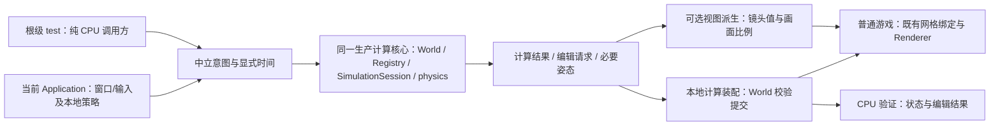
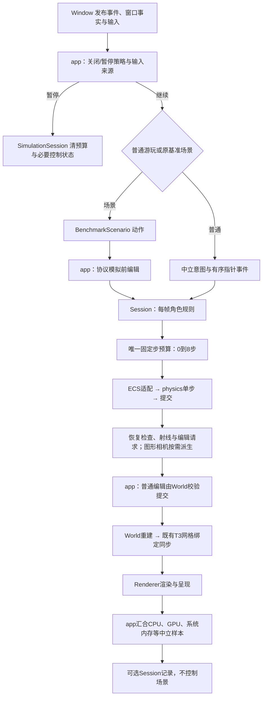

> 2026-10-11 旧导航引用已失效，已改指现行权威或明确归档入口；历史命令、结果和批准含义保持不变。

# M3-T4 完成应用、平台与模拟模块接口正式计划

> 2026-10-10 OpenSpec 迁移后已退役：本页仅保留原文供复核，元数据、待办及“当前”等文字均属原记录时点，不是现役规格、规则或活动计划。T4目标、D/Q选择与验收已迁入change；局部CPU授权不等于完整生产实施。现役入口见 [新权威位置](../../openspec/changes/m3-t4-application-simulation/proposal.md)；来源映射见 [迁移 design](../../openspec/changes/docs-openspec-migration/design.md#来源映射)。旧源未删除，清场须另行确认。

关联规划：[project-scope](../../scope/project-scope.md)。前置契约：[T0 模块边界](../../openspec/specs/module-boundaries/spec.md)、[T1 世界模块](M3-T1-世界模块重构.md)、[T2 SDL3 迁移](M3-T2-SDL3迁移.md)、[T3 渲染器](M3-T3-渲染器重构.md)。设计来源：[对象与数据导向架构初稿](../project-architecture/面向对象与数据导向架构设计初稿.md)。文档组织遵循 [文档治理](../../DOCUMENTATION_MAP.md)：当前契约按模块集中，不要求模板或逐类学习笔记；本页维护目标设计及验收条件，不复制批准台账。完整草稿附录仅作历史快照。

**阅读顺序：** 先看 [[M3-T4-应用平台与模拟模块接口#已确认事项|已确认事项]] 与 [[M3-T4-应用平台与模拟模块接口#方案决策表|方案决策表]]，再看 [[M3-T4-应用平台与模拟模块接口#职责与模块边界|职责边界]]、[[M3-T4-应用平台与模拟模块接口#可独立推进的计算核心与单机组合|计算核心与单机组合]]、[[M3-T4-应用平台与模拟模块接口#物理板块的方案2到方案3迁移|物理迁移]] 和 [[M3-T4-应用平台与模拟模块接口#验收案例|验收案例]]。需要后文对比的决策格均有独立跳转入口。

本文件是 **T4 正式计划：D01–D13 方案及最终接口语义已确认，待整体审核与独立实施授权**。本轮仅完成文档收口，不修改源码/CMake、不执行 T4 测试，不将选型确认等同于节点验收或代码已实现。具体符号与成员清单按本文语义在对应类/数据/系统笔记落地，不重新开放已选方案。完整草稿及选择记录保存在[附录归档](#附录归档)，不再维护独立 draft。

2026-10-09 后续准备授权：用户指定本任务与T3并行承担 **T4-P01接口细化及消费者核对**，材料写入 [m3-t4阶段目录](../../milestones/m3-t4/README.md)。已交付 [接口候选](../../milestones/m3-t4/interface-contract-candidate.md) 与 [消费者静态核对](../../milestones/m3-t4/consumer-audit.md)，新增 [Q01–Q04决策表](../../milestones/m3-t4/interface-decisions.md) 仅涉及实体装配入口、原始键盘事实、关闭报告交接、只读诊断可见范围。D01–D13不重开，Q项未代选，原归档不改写；本次只授权文档/静态核对，未授权物理核心、生产接口或CMake/测试代码实施，也未取消T3交接与正式计划整体审核条件。

2026-10-08 补充确认：T4 建立可独立推进的计算核心，保留当前单机组合；真正拆进程留到后续专项阶段。依据 [[project-scope#长期架构：独立计算服务与渲染客户端|长期架构]] 确定本计划的接口边界及 CPU 验收，不变更已填方案、不重写既有玩法时序，也不授权计算服务或通信实现。

同日最新硬件范围确认：M3 功能/兼容验收只限定本机 RTX 5070 Ti，T2/T3/T4 同步调整；其他 GPU 或第二机器不作为当前节点前置。本机适用项目完成且经用户批准后即可推进，不因缺少另一设备结果阻塞。指定 Y9000P 中端与 GTX 1650 低端整机性能验证仍为下一玩法阶段功能开发前门槛，见 [[project-scope#M3 本机 RTX 5070 Ti 验收与下一玩法阶段性能门槛|当前验收范围与后续性能门槛]]。历史基准与现有未执行状态不变，不扩大物理/计算核心或探针决策范围。

前序状态核对（2026-10-10 文档同步）：生产平台已使用 SDL3，用户已正式批准 [T2 节点](../../milestones/m3-t2/README.md#t2-正式节点批准)，遗留验证与发布风险仍保留；[T3](M3-T3-渲染器重构.md) 的 R1 / Renderer v1 已冻结，R2 顺序1至4已交付 D3D12 与完整游戏转接/候选包，人工/R3 整组和 Vulkan 尚未验收。T4 不撤销既有授权、不由局部结果推定前序全部通过；生产迁移须核对所需前序成立契约/消费者、完成本文整体审核并取得独立实施授权。原草稿状态快照留在归档中。

## 当前设计

新的 Application/Runtime/SimulationSession 组合设计及独立物理 target 暂无已实现版本。下表描述本次读取的活动源码，不覆盖其他任务正在推进的阶段状态。

| 已有行为 | 尚需收束的责任 | 源码与权威入口 |
| --- | --- | --- |
| app 使用 Init/Run/Free，已有异常上报和关闭顺序 | 窗口、Registry、相机、玩家 ID、冷却等仍在 namespace 静态状态；运行循环混合输入、场景、模拟和观测 | [application.cpp](../../../game/app/src/application.cpp)、[app 编排](../../architecture/app.md) |
| Window 为不可复制 PImpl，私有实现已接入 SDL3 和三种窗口模式 | 静态 Init/Free、裸拥有指针 Create、可写 width/height；平台寿命与窗口事实需有受控对象接口 | [window.h](../../../game/modules/platform/include/symocraft/platform/window.h)、[Window](../../architecture/platform.md) |
| 输入有按住态、短按锁存、有序指针事件和恢复处理 | 采集/发布/消费寿命、普通输入与场景输入的隔离责任仍须与 T2 成立契约核对 | [输入状态](../../../game/modules/platform/src/input_state.h)、[T2 输入记录](../../milestones/m3-t2/README.md#s3-输入与窗口行为) |
| Physics::Update 已使用显式 Registry/world，120 Hz、最多 8 个子步 | 单个入口混合共享预算、ECS 遍历、积分、世界查询与碰撞；重力和预算为静态状态 | [physics_system.cpp](../../../game/modules/simulation/src/physics_system.cpp)、[模拟系统](../../architecture/simulation.md) |
| PlayerMath 已有 AABB、接地、体素射线与查询回调 | 通用碰撞数学与玩家移动规则混在同一公开头；没有独立物理数据/构建边界 | [player_math.h](../../../game/modules/simulation/include/symocraft/simulation/player_math.h) |
| telemetry 已使用 SessionConfig 与 Data::Value，保存 CPU/GPU/内存样本并导出 | metadata/startup/completed 仍可直接写；封闭、完成事实与导出责任需要明确；是否采样与是否运行基准路线仍耦合 | [performance.h](../../../game/modules/telemetry/include/symocraft/telemetry/performance.h)、[Session](../../architecture/telemetry.md) |

现有 simulation 单测覆盖数学、输入、相机与延迟编辑请求；独立单步积分/碰撞主循环和多会话隔离仍需补齐。现有阶段报告是各自结果来源，本次没有重新执行测试。

### 公开接口预期行为

本表仅索引已有入口，完整现状契约见链接；不是将旧签名冻结为 T4 v1。

| 入口 | 当前调用方 | 已有行为与限制 | 权威入口 |
| --- | --- | --- | --- |
| Application::Init/Run/Free | main | 静态运行状态，初始化/运行/清理分开，不能假定同实例支持反复开局 | [Application](../../architecture/app.md) |
| Window::Init/Create、PollInt/CaptureInput、Destroy/Free | app/平台测试 | 主线程平台与窗口；输入当前为借用，窗口模式及私有桥接消费 T2 契约 | [Window](../../architecture/platform.md)、[平台桥接](../../architecture/platform.md) |
| Physics::Update/ResetTiming/RayCastStatic | app/交互 | 共享固定步预算；运动与射线读取指定 world，异常不保证整体回滚 | [Simulation 系统](../../architecture/simulation.md) |
| ApplyInput、Character::Player::Update、DoRayCast | app | 每帧规则、相机和编辑请求；交互返回请求，不直接提交世界编辑 | [Simulation 系统](../../architecture/simulation.md) |
| Performance::Session::Add/SetGpu/Invalidate/Export | app/main | 中立记录和导出；当前 Export 混合完成判定，未形成显式 Seal 契约 | [Session](../../architecture/telemetry.md) |

### 私有函数预期行为

| 入口 | 当前内部责任 | 本次处理方向 | 权威入口 |
| --- | --- | --- | --- |
| PrepareWorld/MapInput/UpdateInteraction | app 装配、输入映射、编辑提交 | 保留组合根责任；控制状态移入会话，不向底层传 Application | [app 编排](../../architecture/app.md) |
| IsSolidVoxel | 将 World 方块及定义解释为可碰撞性 | 移入 simulation 世界碰撞适配，不放进独立 physics 核心 | [物理实现](../../../game/modules/simulation/src/physics_system.cpp) |
| ResolveStaticCollision 及碰撞数学 helper | 静态方块碰撞与接地 | 按最小物理数据提取并测试，先保留算法及扫描顺序 | [Simulation 私有入口](../../architecture/simulation.md) |
| SDL 事件处理与窗口事实同步 | 私有平台状态更新与输入发布 | 保持 T2 实际行为，不直接推进 simulation/ECS | [窗口实现](../../../game/modules/platform/src/window.cpp) |

## 本次变更

### 目标与范围

目标：以明确对象管理会话、资源和不变量，以简单数据和函数表达输入、组件及计算；让 app 只负责组合和帧编排，平台只发布事实，simulation 只推进规则，physics 核心只执行运动/碰撞，telemetry 只整理样本。在当前单机组合中分清计算与呈现，使相同生产计算核心能够由纯 CPU 调用方显式推进，不以窗口或渲染帧作为运行前提。

| 交付范围 | 必须成立的边界 |
| --- | --- |
| 应用接口 | game/app 私有 Application 实例拥有运行对象，无活动 namespace 全局玩法状态；创建、运行和关闭有可验证行为 |
| 平台接口 | 一个活动 Runtime 配对平台寿命，Window 独占原生资源并返回中立尺寸/输入；原生能力仅走 T2/T3 私有桥接 |
| 模拟接口 | SimulationSession 绑定稳定 World/Registry，拥有唯一固定步预算、Controller 与镜头值；输出自有选择、编辑请求及必要姿态/统计，图形相机描述单独派生 |
| 可独立推进的计算核心 | 同一生产 simulation/physics/World/ECS 组合接受中立意图和显式时间；纯 CPU 调用方无需创建 Runtime/Window/Renderer，仍能推进必要世界与实体状态 |
| 独立物理板块 | 当前采用方案2：simulation 下独立目录和 CPU target；核心不认识 ECS、World、窗口或 renderer |
| 观测接口 | Session 封闭/导出受控，运行场景与样本记录职责分开；D06 方案1将额外探针档位及裁剪留后续 |
| 跨阶段交接 | 保留 T1 世界/网格语义、T2 输入/窗口行为和 T3 Renderer v1；D02 方案2将正式模块迁移安排在 T5 审计后、NPC 物理复用前的独立节点 |

不包含：通用 Engine/服务定位器、事件总线、运行中切换世界/图形后端、输入回放产品功能、全玩法固定步重写、相机插值、并行物理、新 ECS/SoA、完整刚体动力学、实体间碰撞、旋转形状、CCD、NPC AI、村落演化、micro voxel 碰撞、细体素世界、第三方物理库或第三方 RHI 接入。独立计算服务/渲染客户端产品、拆进程、IPC/网络/共享内存、跨进程协议冻结、重连/预测/部署也不进入 T4；只形成实际计算边界及测试入口，不创建空模块或通用服务框架。

### 已确认事项

| 来源                  | 已确定方向                                                                      | 不在本轮重新选择的内容                                                                           |
| ------------------- | -------------------------------------------------------------------------- | ------------------------------------------------------------------------------------- |
| 2026-10-08 本聊天      | 当前选物理方案2，逐步迁至方案3                                                           | 不再退回仅分文件夹；也不跳过内部独立 target 阶段直接宣布正式模块完成                                                |
| 架构初稿 Q1/Q2          | 按状态/资源/不变量决定对象；当前不加 Engine/GameSession                                     | 不全工程类化，不以 T4 重开顶层引擎框架                                                                 |
| 架构初稿 Q4             | 精简仅复制玩家状态的相机实体；Camera 管镜头，位姿从玩家组件派生                                        | 保持现有镜头/控制语义，不新增独立可写相机姿态或第三人称系统                                                        |
| 架构初稿 Q9             | 不立即统一 SoA、并行或替换 ECS                                                        | 组件继续满足当前存储约束，正确性审计仍归 T5                                                               |
| 已审核探针方向             | 深度采集显式启用，Session 是观察者，不拥有被测系统                                              | D06已选方案1；不采用DLL/代码注入，不新增Off/Basic/Deep或裁剪包，额外档位留后续                                |
| T1/T2/T3 既有决策       | 现有世界契约、SDL3 与输入手感、D3D12 先行及双现代验收                                           | 不重选窗口库，不扩大公开 RHI，不提前将 GL 最终退役并入 T4                                                    |
| 2026-10-08 本聊天与长期规划 | T4 先建立可独立推进的计算核心，保留单机组合；长期渐进形成 dedicated compute server + render client    | 本阶段不拆进程，不把窗口状态变成计算核心的运行前提，不重新选择物理路线或引入服务器框架                                           |
| 2026-10-08 最新本机验收范围 | T2/T3/T4 当前功能/兼容只在本机 RTX 5070 Ti 验收；中低端整机性能验证仍前置于下一玩法功能开发                  | 不等待其他 GPU/第二机器，不称双机通过，不改变历史结果、60 FPS 中端目标或待确认低端预算                                     |
| 2026-10-09 本聊天      | T4 保持零物理步时的现有跳跃语义，并保留旧新对照验收                                                | 不新增玩法输入缓冲、落地前预输入或离地宽限；输入缓冲选型移入 [future-scope](../../scope/future-scope.md#f01-角色输入缓冲) |
| 2026-10-09 本聊天      | D08 选择方案2：观测记录封闭后不可变，导出失败可显式重试，成功后重复导出幂等                                   | D06 仍为方案1；不新增探针档位、独立快照导出器、整套文件事务或崩溃后恢复                                                |
| 2026-10-09 本聊天      | D09 选择方案1：单次 Advance 返回最小自有结果；实施时注释说明当前取舍与方案2触发条件，落实后同步渐进式 architecture 文档 | 不提前采用调用方输出缓冲，不复制完整 World/ECS，不将选型确认视为 T4 源码实施授权                                       |
| 2026-10-09 本聊天      | D10 选择方案1：app 持有自有 InputFrame，与平台交换复用事件容器，按已确认暂停/恢复及基准例外清理                 | 不重选 D07，不新增玩法输入缓冲、归还令牌或缓冲池；交接后记录不借用 Window                                            |
| 2026-10-09 本聊天      | D11 选择方案1：调用方传显式经过时间，会话统一校验/裁剪；参数拒绝与推进中失败分开                           | 保持两层时间限制、零时间和 D04/D10 边界；方案3已校验时间值仅列入 future-scope，达到触发条件后另行选型，不在 T4 实施 |
| 2026-10-09 本聊天      | D12 选择方案1：无窗口CPU装配与普通Application组合逐次对照，离散值精确一致，浮点按已确认字段/绝对阈值比较      | 两边调用同一生产CPU模拟，不是CPU/GPU算法对比；用例、失败/视图/寿命边界一并锁定，不承诺跨平台或不同dt序列等价 |
| 2026-10-09 本聊天      | D13选择方案1及最终接口落点：成功返回自有结果，参数拒绝/推进失败用中立具名异常；double秒、同步只读输入借用    | 不修改D04/D11失败保证，不借用renderer错误类型或统一全工程错误框架，不将Logger输出当错误传播，不授权T4源码实施 |

审核来源见 [[面向对象与数据导向架构设计初稿#审核清单|原决策清单]] 与 [[面向对象与数据导向架构设计初稿#R03 性能探针与观察者边界|探针意见答复]]。物理方案的历史比较和最终路线见下表 D01。

### 方案决策表

**填写规则：** 最终选择以用户填写或本聊天明确确认的记录为准；D01已确认，D02–D07已有用户填写，2026-10-09确认D08方案2、D09–D13方案1，全部选型讨论已收口。各项原候选保留比较，运行开销待测；不虚构测量结论。表内At Links分隔符已转义。

#### D01 物理组织路线

| 最终敲定方案 | 候选方案1 | 候选方案2 | 候选方案3 |
| --- | --- | --- | --- |
| 已确定：当前方案2，逐步迁方案3；2026-10-08 用户确认。[[M3-T4-应用平台与模拟模块接口#D01 物理组织路线对比\|方案对比]] | simulation 内仅分文件夹，共用原 target；未采用 | simulation 下独立物理板块与 CPU target；当前采用 | game/modules/physics 正式模块；作为后续迁移目标，不直接跳过方案2 |

#### D02 正式 physics 模块的迁移节点

| 最终敲定方案                                | 候选方案1                              | 候选方案2                                      | 候选方案3                                   |
| ------------------------------------- | ---------------------------------- | ------------------------------------------ | --------------------------------------- |
| 2[[M3-T4-应用平台与模拟模块接口#D02 正式模块迁移节点对比\|方案对比]] | T4 内：先完成方案2并验证，再搬至正式模块；方案3纳入 T4 必验 | T4 交付方案2；T5 审计后另立迁移节点，在 NPC 物理复用前完成方案3（推荐） | T4 交付方案2；在下一玩法阶段引入第二类实体运动时，先完成方案3再扩展调用方 |

#### D03 只读碰撞查询的绑定方式

| 最终敲定方案                              | 候选方案1                     | 候选方案2                | 候选方案3                                |
| ----------------------------------- | ------------------------- | -------------------- | ------------------------------------ |
| 1[[M3-T4-应用平台与模拟模块接口#D03 碰撞查询绑定对比\|方案对比]] | 借用上下文与函数指针的窄查询值（推荐）；只同步使用 | 模板查询回调；调用侧实例化，不引入虚接口 | 窄只读虚接口；world 适配实现接口，不将完整 World 暴露给核心 |

#### D04 运动数据交接与失败保证

| 最终敲定方案                                 | 候选方案1                            | 候选方案2                               | 候选方案3                            |
| -------------------------------------- | -------------------------------- | ----------------------------------- | -------------------------------- |
| 1[[M3-T4-应用平台与模拟模块接口#D04 数据交接与失败保证对比\|方案对比]] | 每实体小型值输入与结果，成功后提交该实体（推荐）；不承诺整步回滚 | 借用明确的 inout 运动数据，原地计算；失败可能部分写入，终止会话 | 整个物理子步用暂存批次计算，全成功再提交；多子步/整帧不自动回滚 |

#### D05 普通输入与基准输入的隔离责任

| 最终敲定方案                              | 候选方案1                                | 候选方案2                                     | 候选方案3                                 |
| ----------------------------------- | ------------------------------------ | ----------------------------------------- | ------------------------------------- |
| 1[[M3-T4-应用平台与模拟模块接口#D05 输入隔离责任对比\|方案对比]] | platform 发布事实，app 按运行配置筛选并选择输入来源（推荐） | platform 保留中立采集 profile，app 选择消费普通输入或场景意图 | T4 暂保留 T2 当前筛选实现，只分离 app/会话；策略收束另立后续项 |

#### D06 T4 性能观察的交付深度

| 最终敲定方案                                 | 候选方案1                                       | 候选方案2                                      | 候选方案3                                     |
| -------------------------------------- | ------------------------------------------- | ------------------------------------------ | ----------------------------------------- |
| 1 [[M3-T4-应用平台与模拟模块接口#D06 性能观察交付深度对比\|方案对比]] | 本次完成 Session 封闭与场景分离，保持现有启动行为；额外档位/裁剪后续（推荐） | 同时完成启动式 Off/Basic/Deep 装配；默认档位、频率和容量在正式化前定 | 同时交付裁剪轻量包与可分析 Release 包，启动能力具名检查；增加包/构建矩阵 |

#### D07 输入记录的跨边界交接

| 最终敲定方案                               | 候选方案1                          | 候选方案2                            | 候选方案3                     |
| ------------------------------------ | ------------------------------ | -------------------------------- | ------------------------- |
| 1。[[M3-T4-应用平台与模拟模块接口#D07 输入交接方式对比\|方案对比]] | 复用/转移自有 InputFrame（推荐）；不强制逐帧分配 | 同步借用只读视图；明确下次采集/Reset/Destroy 失效 | 复制自有快照；消费者最独立，需测事件容器复制及分配 |

#### D08 观测封闭与导出

| 最终敲定方案 | 候选方案1 | 候选方案2 | 候选方案3 |
| --- | --- | --- | --- |
| 已确定：方案2；2026-10-09 用户确认。[[M3-T4-应用平台与模拟模块接口#D08 观测封闭与导出对比\|方案对比]] | 封闭后仅一次导出；失败保留部分文件与诊断，不允许重试 | 封闭后不可变；导出失败可显式重试，成功后重复调用返回原结果且不再写文件（已选） | Session 交出自有不可变快照，由独立导出器处理保存与重试 |

#### D09 计算入口与结果交接

| 最终敲定方案 | 候选方案1 | 候选方案2 | 候选方案3 |
| --- | --- | --- | --- |
| 已确定：方案1；2026-10-09 用户确认。[[M3-T4-应用平台与模拟模块接口#D09 计算入口与结果交接对比\|方案对比]] | 单次 Advance 返回编辑请求、选择、必要姿态及推进统计组成的最小自有结果（已选） | 调用方提供自有输出缓冲，Advance 写入明确结果容器并另返回执行状态 | Advance 返回编辑请求，姿态与统计通过独立只读入口按需取得自有值 |

#### D10 InputFrame 复用与暂停恢复

| 最终敲定方案 | 候选方案1 | 候选方案2 | 候选方案3 |
| --- | --- | --- | --- |
| 已确定：方案1及下文清理/恢复边界；2026-10-09 用户确认。[[M3-T4-应用平台与模拟模块接口#D10 InputFrame 复用与暂停恢复对比\|方案对比]] | app 持有已清空的自有 InputFrame，平台交换事件容器并填入本次事实；全部消费者结束后清内容、保留容量，下次交接继续交换（已选） | 平台转出自有记录，app 消费后显式归还空缓冲；增加归还入口及寿命规则 | 独占记录与缓冲池，消费后归池；池寿命独立于 Window，另定池耗尽与身份规则 |

#### D11 Advance 时间参数与错误边界

| 最终敲定方案 | 候选方案1 | 候选方案2 | 候选方案3 |
| --- | --- | --- | --- |
| 已确定：方案1及下文时间/错误边界；2026-10-09 用户确认。[[M3-T4-应用平台与模拟模块接口#D11 时间参数与错误边界对比\|方案对比]] | 调用方提供显式经过时间，由会话统一校验、裁剪，再推进（已选） | 调用方先处理为合法时间，会话只校验、不裁剪 | 中立工厂生成已校验时间值，会话只接受该类型；仅作为后续可能选型，见 [future-scope F02](../../scope/future-scope.md#f02-已校验时间值与推进接口) |

#### D12 CPU与本地组合对照标准

| 最终敲定方案 | 候选方案1 | 候选方案2 | 候选方案3 |
| --- | --- | --- | --- |
| 已确定：方案1及下文字段、阈值与用例边界；2026-10-09 用户确认。[[M3-T4-应用平台与模拟模块接口#D12 CPU与本地组合对照标准对比\|方案对比]] | 逐次推进及World提交后对照，离散值精确一致，浮点按字段绝对容差（已选） | 逐次对照所有有效字段，浮点也要求位级一致，不按对象原始字节比较 | 仅在关键检查点比较状态与主要行为，不比较每次推进 |

#### D13 计算接口的错误表达与最终落点

| 最终敲定方案 | 候选方案1 | 候选方案2 | 候选方案3 |
| --- | --- | --- | --- |
| 已确定：方案1及下文最终接口落点；2026-10-09用户确认。[[M3-T4-应用平台与模拟模块接口#D13 计算接口错误表达对比\|方案对比]] | 成功返回D09自有结果，参数拒绝/推进故障用中立具名异常区分（已选） | 操作专用结果显式表达成功/拒绝/失败，适配既有异常，不新增通用Result框架 | 参数拒绝返回状态，推进中故障用具名异常；调用方同时处理两条错误出口 |

**选型收口：** D01–D13已有填写/确认，这组总体选型讨论已结束。A24–A26按D12，时间、输入借用及错误表达按D11/D13；前序接口消费者核对、正式spec整体审核与独立实施授权仍须成立，不另引入不同时间、回滚或比较规则。P01新增Q01–Q04只细化原契约未冻结的装配/事实/关闭/诊断表面，不修改D01–D13；具体符号命名和成员清单在对应类/数据/系统笔记按已选语义落地，不作为重新选型的理由。

D13最终落点：显式经过时间用double秒，会话保持D11先校验/裁剪再转float的原路径；中立意图按const引用、有序中立指针事件按同步只读span输入，不保存其地址，app仍按D07/D10拥有InputFrame，结果仍按D09自有。异常携带拒绝/推进失败类别、操作/阶段和可确定已提交范围；D03查询出错不能用“非碰撞”false代替，D04提交保证不变。只约束simulation/physics计算接口，不复用renderer错误类型、不统一全工程异常体系、不承诺计算入口noexcept或内存耗尽时完整分配诊断；具体名称/字段由正式接口清单与对应类笔记一致落地。方案确认不等于代码已实现或阶段实施授权。

### 职责与模块边界

| 对象 / 能力                  | 功能与作用                      | 负责 / 不负责                                                | 输入、输出与所有权                                                                                     |
| ------------------------ | -------------------------- | ------------------------------------------------------- | --------------------------------------------------------------------------------------------- |
| app 私有 Application       | 装配当前单机运行，连接模块并编排帧          | 拥有运行配置与各对象，施加本地暂停策略并提交既有编辑；不计算碰撞，不直接写 Session 容器，不供底层回读 | 启动配置→RunResult；独占 Runtime/Window、World/Registry/会话、既有 Renderer/Bindings及可选观测/场景；此组合不构成永久同进程限制 |
| Platform::Runtime        | 配对平台库初始化与终止                | 一个活动主线程 runtime；不决定玩法和后端，不释放外部持有的平台子系统责任                | 配置→平台可用范围；拥有自己取得的 SDL 初始化责任，所有 Window 先结束                                                     |
| Window                   | 管一扇窗口、输入缓冲和窗口事实            | 不修改 ECS，不执行 GPU 绘制；保留 T2 三模式/私有桥接                       | WindowConfig→窗口/尺寸/输入；独占原生资源，借用 Runtime，原生类型私有                                                |
| SimulationSession        | 管一份世界/Registry 的模拟会话       | 唯一固定步预算、暂停恢复、控制器、镜头值及玩家恢复规则；不轮询窗口或写 GPU，推进不依赖画面比例       | 意图/显式时间→选择/编辑请求及必要姿态/中立统计；图形相机另行派生；World/Registry 为非拥有借用                                      |
| Controller / 角色规则        | 意图转运动规则及交互请求               | 管选材、冷却和一次性输入消费；不承担物理步预算或直接提交世界编辑                        | 中立意图/角色数据→运动修改与请求；不缓存组件地址                                                                     |
| 物理核心                     | 单步运动及静态方块碰撞/空间查询           | 不遍历 ECS，不认识 World，不生成网格、编辑世界或控制角色                       | 运动值/形状/配置/只读查询→运动结果；输入与查询只在本次调用有效                                                             |
| simulation 的 ECS/世界适配    | 把存储和方块语义连接到核心              | 按步取数据、提交结果、解释可碰撞性；不把具体对象交给核心                            | 借用本步 Registry/world；无另一套长期权威运动存储                                                              |
| Camera 镜头值               | 保存 FOV/裁剪范围，按需派生中立相机描述     | 玩家组件是位姿权威；无仅用于复制玩家姿态的相机实体，图形描述不是推进世界的前提                 | 镜头配置/玩家姿态/像素比例→T3 成立的相机输入；玩法朝向/射线不依赖 GPU 投影                                                   |
| app 私有 BenchmarkScenario | 管既有 static/walk/edit 路线与游标 | 产生场景动作；不采样统计，不轮询窗口，不启动另一个进程                             | 时间/必要状态值→意图/模拟前编辑请求；不拥有被测 World/Registry                                                      |
| Performance::Session     | 收样本、关联 GPU、标无效原因、封闭并导出     | 不发 query、等待 fence、截图、采内存、控制角色或启动游戏                      | 中立样本/配置/元数据→原记录与摘要；拥有记录，不保留运行对象指针                                                             |

Runtime/Application/Window 是资源或组合所有者；Session/Controller 管状态；组件、相机描述和物理结果保持简单数据。数学、序列化和无隐藏状态的单步求解可继续是函数。物理如确有配置/复用工作区才建立轻量实例；不虚构 PhysicsWorld、统一 System 基类或逐实体虚函数层。

资源根若需从当前隐式定位改为显式上下文，可配套已审核的小型 AssetLocator；保留路径约束及独立工作目录运行，不扩为缓存/资源管理器，不把 assets 重构变成物理提取前置。

### 可独立推进的计算核心与单机组合

“计算核心”是已有 simulation/physics/World/ECS 的职责组合，不是新增 compute 模块、另一个物理世界或通用 Engine。T4 交付的是 **同进程逻辑拆分与无窗口推进验证**：普通游戏继续由 Application 同时装配计算侧与呈现侧；根级 test 的 CPU 调用方直接消费相同生产 target，不重新实现算法或要求产品提供专用服务器启动项。

| 审核重点 | T4 必须形成的边界 | 保留的现状与后续限制 |
| --- | --- | --- |
| 装配与推进 | 玩法必需的数据加载、World/Registry/会话可在无 Runtime/Window/Renderer 的条件下成立；时间由调用方显式提供，不从窗口或 GPU 取时间 | 生产 Application 仍保留现有单机启动/关闭路径；无窗口不等于无玩法资产，不要求新增服务器可执行程序 |
| 演化与视图 | Advance 消费中立意图/时间并产生计算结果；FOV/画面比例/投影仅参与按需视图派生，不是推进必需输入 | 镜头值可仍按原设计由会话持有；影响移动、瞄准和交互射线的朝向仍是玩法数据，不新增第二份可写位姿权威 |
| 调度与暂停 | 会话接受显式推进、暂停和恢复；窗口事实先由本地 app 转成策略，不在核心内检测失焦、最小化或等待呈现 | 本地每帧调用一次、角色规则一次、120 Hz 物理最多 8 步及恢复 dt=0 保持；独立服务时钟、AI 频率与后台续算另定，不在 T4 改成全玩法固定步 |
| 编辑与权威 | 意图/交互产生请求，由当前本地计算装配调用 World 校验提交；CPU 调用方能复现同样顺序，无需 GPU 网格绑定 | 普通编辑仍由 app 在模拟后提交，benchmark edit 仍在模拟前；后续迁至计算服务的校验/提交职责，不意味着当前就移入 Advance 或新增命令总线 |
| 数据与寿命 | 需要持有的输出采用自有中立值，按当前会话/实体有效期使用；内部 World/Registry/查询借用不泄漏到外部显示结果 | D03已填绑定方式与D07/D10已选自有交接规则不因该方向改选；不复制完整World/Registry，不将进程内ID宣称为重连/持久化身份，不提前冻结wire protocol |
| 显示副本与观测 | 计算侧是唯一玩法状态裁决者；按需读取的姿态/选择/摘要不是第二份可写权威，纯 CPU 诊断可独立于 GPU 样本成立 | 不在 T4 实现客户端复制或每步全量快照；现有 CPU/GPU 性能协议继续保持，跨进程指标关联后续另定 |

职责关系如下；图中只表示 T4 的本地调用，不表示已经拆进程、启用后台线程或建立通信协议。



CPU 推进入口的场景驱动与诊断放在根级 test，实际计算和中立视图派生仍由生产实现提供。未生成图形相机或未提交 GPU 不影响必要状态推进；未来服务器内部的 World/physics 查询仍是进程内同步调用，不把每次碰撞查询改成 RPC。跨进程身份、状态发布、通信、背压、重连及各进程生命周期留专项 spec，届时提供 3–4 个可行选型，不由本计划默认决定。

#### 已选计算入口与渐进式演进

2026-10-09用户确认D09方案1：单次`Advance(意图, dt)`返回最小自有结果；D13同时锁定中立意图const引用、有序中立事件只读span、double秒及具名异常。时间/参数拒绝与推进失败语义按D11，A24–A26字段、阈值及用例按D12；具体符号命名与成员清单在对应笔记落地，不改变已选入口组织与失败保证。

- 输入只含中立意图、有序中立指针事件及double秒；const引用/span借用只在本次同步调用有效，会话不保存地址，不直接消费平台InputFrame类型。app仍拥有并按D10消费/复用原记录；不传Window、Renderer、Performance::Session或画面比例。每次推进的角色规则、零到多个物理子步及交互顺序沿用本文已选契约。
- 输出只含编辑请求、选择、必要姿态与推进统计等小型自有值，不复制完整 World/Registry，不包含组件地址、World/Registry 指针或 GPU 句柄；下一次 Advance 不改写已返回结果。值返回不承诺零分配或特定复制消除结果，实际成本以生产工作负载为准。
- 普通编辑仍由调用方在 Advance 后经 World 校验提交；按需视图派生使用中立姿态与镜头值，app 适配 T3 输入，不使 simulation 公开头或 target 反向依赖 renderer。省略视图派生不影响必要计算。

**方案2的评估触发条件：** 生产工作负载实测表明结果构建、容量增长或交接形成持续、可复现的分配/复制成本，并影响已确认预算；或结果负载实质扩大，现有值返回路径无法满足明确的容量复用要求。届时先定位成本来源并比较调用方自有缓冲复用，不仅因出现多个实体或看到按值返回就改接口，不预设实体数量、耗时或分配阈值。方案2是否采用仍需基准对照与方案审核，不由触发条件自动授权。

**演进必须保留：** 结果仍由调用方拥有，旧结果保留与显式覆盖规则清楚；不得换成会话内部借用、共享静态缓冲或第二份可写权威。采用方案2前明确缓冲别名、容量、覆盖及失败后状态，保持 D04 提交边界、玩法时序与 CPU/本地组合行为，并更新正式契约及回归证据；不默认长期维护两套推进实现。

**代码注释与 architecture 交付：** T4 实施时在 Advance 的结果构建/交接处写简洁设计注释，说明当前选择最小自有值返回的理由、调用方所有权及方案2的评估触发条件，并指向 D09；不是只留下空泛 TODO。实现和验证落实后，在 [simulation 实际系统笔记](../../architecture/simulation.md) 记录入口/消费时点，在 [数据笔记](../../architecture/simulation.md) 记录字段/所有权，并由 [功能笔记](../../architecture/simulation.md) 链接。按“当前设计、触发条件、演进路径”表达渐进式设计，关联真实源码与验证版本；不提前把候选写成已实现，不创建平行架构真相。

#### CPU与本地组合对照契约

2026-10-09 用户确认D12方案1及以下字段、阈值与用例边界。对照的是同一生产CPU模拟的两种装配：根级test直接装配World/Registry/SimulationSession，不创建Runtime/Window/Renderer；普通Application组合装配相同计算侧，并接入窗口、输入及Renderer。不是CPU与GPU求解算法对比，也不以另写一套模拟或假Renderer替代生产路径。

选择理由：逐次对照可定位首次分歧，按字段约束浮点而不将全部数值位级一致写成契约；关键玩法结果仍精确一致。下列数值是已确认的验收阈值，不是本轮实测结果，不扩大为生产算法的碰撞/接地容差。

| 对照契约 | 行为与字段范围 |
| --- | --- |
| 相同条件 | 同源码/构建条件、配置、玩法资产/seed与初始状态，同一中立意图、有序指针事件、显式经过时间和编辑序列；脚本与记录由根级test维护，不把两轮人工实时输入/墙钟差直接当相同序列，不新增输入回放产品功能 |
| 对照时点 | 每次Advance返回后比较计算结果/必要状态；World校验提交后另比较编辑结果及相关方块值。普通编辑仍在模拟后，benchmark编辑仍在模拟前；拒绝及失败分支也在对应出口核对状态 |
| 离散值精确 | 接地、跳跃及待跳状态、sensor/重力、选材、物理步数、命中存在性/格坐标/法线方向、编辑请求存在性/操作/坐标/方块ID/顺序、World编辑状态/拒绝原因及相关方块值均精确一致；无命中/无请求不比较无语义字段 |
| 身份与排除项 | 实体以测试逻辑角色对应，不要求独立会话的原始EntityId/WorldId相等；不比较对象地址、GPU句柄、渲染网格构建次数/版本或实际耗时，不复制完整World/ECS作为每次返回结果 |
| 数值判定 | 有效浮点字段须有限，向量逐分量比较；使用下表固定绝对误差上限，不随坐标或推进次数放宽，不增加相对容差。NaN/无穷不能通过；即使浮点差异在容差内，接地/命中/编辑等离散结果不同仍失败 |
| 状态采集 | D09结果保持最小自有值；余数、冷却或提交范围等必要诊断用中立只读值/受控测试采集，不公开可写内部状态、组件地址或整Registry。检查不得推进预算、触发规则或影响玩法 |
| 视图与旧结果 | 同一序列增加、省略或重复视图派生/呈现，不改变计算状态或旧返回结果；非法画面比例只使视图派生失败。FOV是角色镜头值的比较，不要求纯CPU生成投影矩阵 |
| 失败与证据 | 参数拒绝前后模拟状态/余数不变；推进中故障按D04/D11核对已提交范围和Failed后禁止推进，不冒称整帧回滚。失败证据给出用例/版本、序列位置、字段/左右值/阈值或具名错误与提交阶段；不以诊断文字完全一致代替错误语义比较 |

| 浮点字段 | 已确认绝对误差上限 |
| --- | --- |
| 位置、速度、加速度、射线距离 | 各有效分量不超过1e-4；位置/距离沿原世界单位，速度/加速度沿原单位。量级沿用 [现有数值测试](../../../test/unit/simulation/simulation_contract_tests.cpp)，不视为本轮对照已通过 |
| yaw、pitch、FOV | 不超过1e-4度；保持原角度语义，不通过额外取模/规整掩盖状态差异 |
| 冷却时间 | 不超过1e-6s |
| 固定步余数 | 不超过1e-9s；物理步数仍必须精确一致，预算算法/原有取整容差不因此改变 |
| 有效规则时间 | 同输入、同归一化路径下精确一致，不使用浮点容差放宽 |

必须覆盖零步/多步/长帧、有效跳跃、碰撞与支撑移除、指针逐事件裁剪、冷却与编辑拒绝、暂停恢复、双会话隔离；同时覆盖非法参数拒绝后状态不变及显式修正、推进失败后的部分提交/禁止继续推进、视图可选/重复/非法比例及旧结果寿命。测试失败不得通过扩大阈值或改输入/调度掩盖；如确需改标准，留首次失败与原因并另请用户确认。

A24验证真实无窗口路径及链接边界，A25验证D12逐次对照，A26验证策略/视图/寿命边界；这些不替代T2真实SDL输入或A22真实现代后端回归，不承诺跨平台确定性或不同dt序列得到相同结果。

### 物理板块的方案2到方案3迁移

#### 可行性与必须保留的行为

可行性判断：现有碰撞只需要运动/形状数据与“该格是否可碰撞”，已有查询回调可复用；主要工作是拆调度、存储适配和数据契约，不需要先引入通用物理库。结构工作可逐步验证，行为回归是主要风险，不据此估算 FPS 提升。

- FixedStepBudget 从物理全局状态移到 SimulationSession；保留 120 Hz、最多 8 步、现有长帧裁剪及暂停重置。核心一次只执行一个明确固定步，不第二次 Consume。
- 保留现有“位置推进→加速度→重力→速度限制→碰撞/接地”的顺序、碰撞扫描/平局处理、接地容差和 sensor 语义；不顺便换积分器、轴顺序或增加扫掠碰撞。
- 角色规则在每次会话推进中执行一次；当前单机 app 每帧调用一次，物理执行零到多个子步。有序指针事件、跳跃消费、冷却和普通编辑不在每个子步重复；CPU 调用方按相同输入/时间序列复现，不要求存在渲染帧。
- 2026-10-09 用户确认：零物理步时保持现有跳跃语义。沿用当前跳跃前提；角色规则接受有效跳跃时立即设置向上速度、清除接地、设置跳跃状态并消费请求，即使本次物理预算为零也不延迟这些状态修改。位置等待后续正常物理子步推进，不强行补步，不新增跳跃排队、落地前预输入或离地宽限。T4 留旧新对照测试；玩法输入缓冲的后续选型见 [future-scope](../../scope/future-scope.md#f01-角色输入缓冲)，不混同 T2 的按键短按锁存或 D07 的 InputFrame 所有权交接。
- 世界适配保留当前有限世界的 OutsideWorld/高度越界为非碰撞格；未定义方块仍报错，不吞成空气。未来“未加载区块”另选策略，T4 不虚构流式能力。
- 射线结果是值，不带 draw 开关；方块选中、库存、放置保护和 World::EditRequest 仍由 simulation 交互/世界执行负责。

#### 最小数据契约

| 契约数据 | 语义与有效期 | 不进入契约的内容 |
| --- | --- | --- |
| BodyState | 位置、速度、加速度、重力/sensor/接地状态；有限数值，长期权威仍在当前组件 | EntityId、Registry/World 指针、相机朝向、GPU 句柄 |
| AabbShape | 正尺寸与局部偏移；世界轴对齐，坐标单位沿用现有世界 | 旋转刚体/网格形状、从完整 Transform 静默采用缩放 |
| PhysicsSettings / 固定步时长 | 重力、各轴速度上限、现有容差及一个固定步；先保持当前值 | 真实帧累计、窗口时间源、全局可写配置 |
| TerrainCollisionQuery | 单位格→可碰撞性，绑定机制按 D03；只读、同步借用，不保存上下文 | Chunk/BlockDefinition 的完整结构、世界编辑与生成入口 |
| StepResult | 新运动状态与接地事实；失败提交保证按 D04 | 整帧事务、自动实体生命周期、持久资源 |
| RayHit | 命中、格坐标、法线、距离；保持当前边界和无命中语义 | 渲染、选择框资源和方块编辑副作用 |

ECS 适配只暂时读取/提交必要运动值，不复制整个世界或 Registry，不长期持有 span/组件地址。组件继续满足当前 standard-layout/trivial 存储约束，资源不塞进组件。BodyState 是计算契约，不是新建第二个物理世界。

#### 软边界与硬边界

以下为 T4 实施落点；本轮不创建目录或 target：

```text
game/modules/simulation/
  CMakeLists.txt
  include/symocraft/simulation/       # 会话、意图、结果等对 app 的契约
  src/                               # 角色/交互/镜头与 ECS/World 适配
  physics/
    CMakeLists.txt                    # 方案2阶段定义 symocraft_physics
    include/symocraft/physics/        # 独立数据/单步/查询契约
    src/                             # 积分、碰撞和空间查询实现
game/app/src/                        # Application、场景和输入策略，均私有
test/unit/physics/                   # 无 ECS/World/窗口的真实核心测试
test/unit/simulation/                # 会话/适配/角色与交互测试
test/integration/                    # 真实组合、平台、部署及回归
```

| target | 依赖与可见范围 | 必须验证 |
| --- | --- | --- |
| symocraft_physics | 仅标准库与 foundation 数学契约；独立 include 根，不获得 simulation 的 include/src 根 | 不直接或传递依赖 ecs/world/scene/platform/renderer/assets/telemetry/app 或图形 SDK；独立消费者能编译运行 |
| symocraft_simulation | 单向消费 physics；ECS/World 适配在自身 src；物理契约优先不向 app 传播 | 公开会话头不泄漏物理实现/原生平台；不得 physics→simulation 形成环；会话 CPU 消费者不直接或传递链接 platform/renderer/app 或图形 SDK |
| platform / telemetry | 保留 T0 的正式 target，只完善本阶段契约与实现 | simulation/physics/telemetry 的 CPU 路径无窗口/GPU；telemetry 不依赖 app/renderer |
| game/app 目标 | 链接正式模块，私有装配运行对象 | 底层不反向链接 app；生产不依赖 test/support，测试链接真实生产实现 |

从第一天采用稳定的 `symocraft_physics` target、`symocraft/physics/...` 头路径与 `SymoCraft::Physics` 命名空间；方案2的公开头只给声明的 simulation/测试消费者使用，不先宣称第十个正式生产模块已成立。若公开会话签名确需某个 physics 数据类型，实施前在接口清单逐项说明传播理由与 PUBLIC 依赖，不能导出整个 simulation 私有目录。

迁方案3时将上述 physics 子树及 target 定义所有者移到 `game/modules/physics/`，保留 include/namespace/target 与行为；依赖方向不变。更新模块清单、根构建组织、边界检查和实际架构索引，不修改 T0 历史报告，也不复制两套物理实现。

#### 迁到正式模块的退出条件

| 条件 | 所需证据 |
| --- | --- |
| 真正独立 | 核心独立 Debug/Release 构建与消费者通过，禁止依赖/include 负向检查成立 |
| 调度和状态已隔离 | 两份 CPU 会话交错推进不共享余数/冷却，旧全局预算和活动直连入口已撤掉 |
| 查询/存储适配单向 | World/ECS 适配不进入核心，借用只同步使用，无反向 target 环 |
| 行为有基线 | 单步、碰撞、查询及现有玩法/协议回归有结果；失败保证按 D04 留证 |
| 迁移可核对 | 单一实现、消费者头与 target 不变，发布/CPU/工具矩阵和正式模块文档同步 |

D02已填写方案2：T4交付simulation下内部独立物理target；T5审计后另立迁移节点，在NPC物理复用前完成正式physics模块。该节点仍须独立授权/验收，不把正式模块搬迁设为T4门槛，也不把“后续”解释成永久不迁移。

### 接口与调用行为

下表定义已选的可观察行为，不是已实现的完整头文件。数据语义与失败边界以 D01–D13 为准，具体名称/字段在对应笔记及实施前接口清单落地；输入/相机使用前序成立的数据契约，不另造第二套 Renderer API。

| 入口 | 调用方 / 输入输出 | 前提、所有权与失败后的状态 |
| --- | --- | --- |
| Application 创建 / 装配 / Run / Shutdown | main 提供自有 app 配置，Run 返回自有退出/完成结果 | 先建立组合根/可选记录，再显式装配；成功才进入可运行状态，失败保留诊断及可关闭的 owner；一实例一次 Run、主线程非重入，Shutdown 幂等，析构不抛异常；不向模块传 StartupOptions |
| Runtime 创建 / 关闭 | app 拥有平台运行范围，Window 借用它 | 一个活动 runtime/窗口的既有范围；只释放自身初始化责任，不终止外部 SDL owner；有活窗口时不能先结束 runtime |
| Window 受控创建 / FramebufferSize / 输入交接 | 返回明确独占 owner、中立尺寸与输入；D07自有交接，D10由app持有记录并交换复用事件容器 | 隐藏可写 width/height 与原生类型；交接后的记录不借用Window，平台Reset/销毁不改写它；保留T2窗口事实/短按/held/Wait行为，D05决定隔离层 |
| SimulationSession 创建 / Advance | D09方案1：绑定本会话 World/Registry，消费中立意图/显式经过时间，由D11统一校验/裁剪；返回选择/编辑请求及必要姿态/推进统计组成的最小自有结果 | 每次 Advance 串行，旧返回值不被下次推进改写；参数拒绝在修改状态/消费预算前，不进入Failed；推进中错误按D04进入Failed，不在此提交普通World编辑或呈现，画面比例不是必需输入 |
| 按需图形相机派生 | 使用已有镜头值、玩家姿态与有效像素比例，返回自有中立视图数据，由 app 适配 T3 成立的相机输入 | 纯计算调用方可不调用；不引入simulation对renderer的反向依赖，不推进规则/预算或增加可写相机实体，非法视图参数具名报告且不改动已成立的模拟结果；保持本地相机/射线与编辑时序 |
| SimulationSession Pause / Resume / 玩家恢复 | 本地 app 或 CPU 调用方传显式暂停/恢复，会话收束预算及必要控制状态 | 恢复帧不追赶暂停时间；核心不自行解释窗口状态；重生沿用安全出生点行为，不承诺重新创建整个会话 |
| 物理单步 / 射线查询 | simulation 适配传运动/形状/查询，得到中立结果 | 核心不累计时间，不保存借用；数值/形状/查询错误具名报告；写入边界按 D04，不冒称整帧回滚 |
| Controller 输入 / 交互 | 每帧意图及有序事件，产生运动规则/选择/编辑请求 | 指针只一条消费路径；选材与放置冷却为实例状态；放置拒绝的原冷却语义保留 |
| BenchmarkScenario 推进 | app 传实际时间和必要状态值，得到意图/模拟前编辑动作 | 不由 Session 指针隐式启停；编辑时间/顺序、预条件和 workload版本保持原协议 |
| Session Add / 关联 GPU / 标注无效 / Seal / Export | app 传样本与具名最终事实；Session 输出原记录、摘要及独立导出结果 | 记录 Recording→Sealed；导出结果独立为未尝试/失败/成功。Seal 后记录不可变，失败可显式重试，成功后重复导出不再写文件；完整规则见下节 D08 已确认契约 |

Session 的 metadata/startup/completed 改为受控记录/完成入口，保留 Data::Value 冷路径契约，不重新公开 YAML::Node。统计函数只处理指定数据，不排序原始帧容器破坏 GPU 关联；帧号、迟到/缺失 GPU 与记录上限的规则需写入类笔记。完整 Seal 并不承诺强制等 GPU，也不承诺外部文件写入一定成功。

### 输入交接与暂停恢复契约

2026-10-09 用户确认 D10 方案1及以下边界；这是 D07 自有记录交接的细化，不是玩法输入缓冲选型。具体 C++ 字段和入口实施前冻结，不能仅换容器而丢掉 [T2 输入事实](../../milestones/m3-t2/s4-platform-handoff.md#输入快照)。

| 契约 | 行为与失败边界 |
| --- | --- |
| 交换与所有权 | app 提供已清空的自有 InputFrame；平台交换已发布事件容器并填入本次事实，不保存调用方对象地址；待发布事件独立保留，不因交换已发布容器而清除 |
| 采集与消费时点 | 在原有采集边界完成键盘采样后交接本次记录；指针逐事件保序，不重复发布或消费短按。app 先处理关闭、暂停及输入来源，再提交中立意图；多物理子步不重复消费本帧输入，不挪采集计时边界造成旧性能口径漂移 |
| 容量回收 | 本帧所有输入消费者结束后，app 清内容、保留容量；下次交接继续交换，无归还令牌或缓冲池。容量复用不承诺零分配，事件突增仍可能扩容 |
| 历史记录 | 需保留历史时另持有独立自有记录；同一个对象显式重新用于采集后不再是旧内容。平台 Reset 或 Window 销毁不得改写已交接记录，也不要求窗口销毁前强制归还 |
| 普通暂停 | app 丢弃尚未消费的旧玩法记录并重置平台待消费输入；会话清移动意图、待跳跃请求、水平速度与固定步余数，不顺带重置库存、镜头、冷却或全部运动状态 |
| 恢复 | 首次恢复推进 dt=0，不追赶暂停时间；重新采纳当前实际 held，不要求先松开再按。旧短按/指针运动不回放，首运动保护保持；持续held按原规则重新起作用不等于旧短按补触发 |
| 同轮失焦再恢复 | 保留一次失焦事实并执行清理/恢复边界，不能只依据最终获焦状态而跳过；窗口回调不直接推进会话或修改ECS |
| Wait与关闭 | Wait只累积事件，不吞首事件；下一次正常发布后交接。关闭请求始终优先，Reset/清记录不清除关闭事实，也不继续新模拟/渲染 |
| 基准输入来源 | D05由app隔离玩家控制并选择场景意图，不靠Performance::Session是否存在决定；普通失焦暂停规则不直接套用基准模式 |
| 基准Escape与最小化 | 已排队且未消费的本窗口Escape跨失焦保留，不采后台全局键盘补取消；最小化沿既有基准无效/重置路径处理。平台发布足以保留该行为的中立事实，迁出策略不是仅删旧筛选代码 |
| 失败 | 分配或采集失败具名报告并沿T2停止发布错误输入，不伪装成本帧无输入；清理与析构不要求回调已失效Window |

app 对旧玩法记录的显式丢弃与对新记录的显式复用不改变 D09 已返回计算结果的寿命；两类自有值不可混用。A06/A09/A20 验证交换回收、事件消费与全部模式边界，恢复测试继续保留真实 SDL/玩法证据。

### Advance 时间与错误契约

2026-10-09用户确认D11方案1及以下边界。选择理由是让普通app与CPU调用方共享时间和错误规则，避免各自归一化形成不同口径；不是改写角色调度或引入新时钟框架。当前依据为 [app时间/规则编排](../../../game/app/src/application.cpp) 与 [固定步预算](../../../game/modules/simulation/include/symocraft/simulation/player_math.h)。D13锁定入口double秒及具名异常，保持原精度转换与计算顺序，不借接口改动悄悄改变取整或容差。

| 契约 | 行为与失败边界 |
| --- | --- |
| 时间来源 | 调用方显式提供以秒表示的有限、非负经过时间；会话不读取窗口/GPU/墙钟。普通app负责本地时钟差及暂停策略，CPU调用方可直接提供相同序列；负值、NaN或无穷不是成功的零时间输入 |
| 角色规则时间 | 会话统一校验后将非负经过时间裁剪至最多0.1s，角色规则与冷却消费同一有效规则时间；保留当前裁剪到float再交给既有规则/预算的数值路径，不能先窄化任意大输入导致溢出 |
| 物理预算时间 | 固定步预算只消费一次上述规则时间，另按120Hz、最多8步及现有余数/容差规则处理；不将规则时间改为最多8/120s，不将原始长帧直接用于冷却，也不增加第二份预算或无限追赶 |
| 零时间 | dt=0合法，仍按既定顺序处理输入、选择、交互与有效跳跃；不把整个Advance当作无操作。物理不强行补步；普通零时间调用保留预算余数，暂停/恢复才按D10重置，首次恢复有效dt=0 |
| 场景与观测时间 | 基准场景的实际经过时间与会话裁剪时间分开，路线/编辑调度不改为使用裁剪时间。返回推进统计能表达有效规则时间以保持simulation_delta_ms原口径；输入采集及各计时起止不因归一化迁移而漂移 |
| 参数预检拒绝 | 在修改角色/镜头/冷却、消费预算或提交运动前完成入口参数预检；非法时间及非有限/不可安全表示的指针输入等具名拒绝，相关会话状态保持，不因拒绝进入Failed。正常相反方向同时按下仍按现有优先级，不新增互斥错误 |
| 修正与重试 | 参数拒绝后，调用方可以显式修正后再调用；不自动重放输入，也不复原平台已经采集/锁存消费的事件。预检不宣称已验证所有World/ECS数据或保证整个Advance无后续失败 |
| 推进中失败 | 开始实际推进后发现世界查询、存储或数值错误，停止后续提交并进入Failed；按D04保留此前已提交实体/子步及已执行角色规则，失败实体的单步结果不提交，不冒称整次推进或整帧回滚 |
| 结果与错误 | 成功、参数拒绝和推进失败可区分，错误具名且保留首个诊断及可确定的阶段/提交范围；结果构建失败也不能伪装成功。诊断按可用资源保留，不承诺内存耗尽时还能分配任意长度字符串 |
| 后续调用与视图 | Failed会话拒绝继续Advance，不自动恢复；Paused会话须显式Resume后推进。非法画面比例只使按需视图派生失败，不改预算、状态或已返回计算结果，也不阻断纯CPU调用 |

方案3“由中立工厂生成已校验时间值”仅列为未来可能的技术选型，评估触发条件及进入限制统一维护于 [future-scope F02](../../scope/future-scope.md#f02-已校验时间值与推进接口)。不是到期自动迁移，也不作为T4实施或验收前置。A08/A13/A14/A26验证本节边界，对照字段、阈值及用例按D12，不再列为待选。

### 计算接口错误表达契约

2026-10-09用户确认D13方案1及最终接口落点。选择理由是保持D09成功结果简洁、贴近World/平台/T3等已重构路径的异常处理；当前工程仍为异常、显式结果和旧Logger/断言并存，不宣称全工程已统一异常。

| 契约 | 行为与失败边界 |
| --- | --- |
| 成功与拒绝 | 成功正常返回最小自有结果；入口参数或调用状态拒绝用中立具名异常报告，拒绝阶段不改角色/镜头/冷却/预算。调用方可显式修正参数后再调用，不自动补输入或继续错误帧 |
| 推进失败 | 实际推进中的查询/存储/数值或结果构建错误先停止后续提交并进入Failed，再报告异常；类别、操作/阶段与可确定提交范围自有，不携带组件/World/Registry地址或可误提交的成功编辑载荷；D04不回滚此前实体/子步/角色规则 |
| 查询与视图 | D03同步查询的正常false仅表示非碰撞，错误具名传播、不吞成空气；物理单步失败不提交该实体结果。视图参数错误仅拒绝该视图派生，不把会话置Failed或改写既有计算结果 |
| 错误归属与调用方 | simulation/physics各自使用中立具名错误，普通app/CPU调用方捕获后按类别及状态处理，不解析文字猜结果；不导出renderer/platform的错误类型，不新增全工程错误基类或通用Result框架 |
| 诊断与内存失败 | 保留首个原因、阶段及可确定提交范围；诊断文字自有且按可用资源保留，不承诺内存耗尽时完整格式化或所有失败均可转成新异常。不得因二次诊断构建失败而继续推进，顶层仍保留未知/分配异常兜底；计算入口不声明noexcept |
| Logger与旧ECS | Logger输出不是错误传播：Error只打印，旧Assert的调试中断/exit不能靠catch转换。适配先验证所用实体/组件等已知前提，实际必需路径的空值/分配失败须具名传播；若旧存储阻断本契约，按本文最小修复/留证，不用日志或Release断言冒充安全。完整ECS/内存审计仍归T5，不在T4改造整个Logger |
| 清理 | 显式关闭保留可报告失败，析构noexcept有界兜底；错误类别不改变D08封闭/导出契约、原退出码或首个诊断保留，不在析构重试推进/导出 |

A13/A14/A26核对正常返回、具名拒绝、推进失败及视图错误；CPU结果对照按D12比较错误语义/阶段和提交范围，不要求异常说明文字完全一致。方案2与方案3仅留比较，不作为第二套活动错误出口。

### 观测封闭与导出契约

2026-10-09 用户确认 D08 方案2。以下为 T4 已选行为，不表示 Session 当前已实现 Seal 或受控导出；D06 保持方案1，封闭与导出继续串行、非重入。

| 契约 | 行为与失败边界 |
| --- | --- |
| 四类事实独立 | 采样是否完成、运行与关闭结果、按既有协议判定的观测有效性、文件导出结果分别记录；无效运行可以成功导出，采样完成不等于正常关闭 |
| 封闭时点 | 停止场景/模拟/新采样，交接已就绪 GPU 样本，完成 Renderer/Window/Runtime 关闭，再汇入所有最终事实并 Seal；部分启动失败也保留最终关闭与诊断事实 |
| 封闭后不可变 | Add、GPU 回填、metadata/startup、完成事实及无效原因等记录写入具名拒绝；Export 只保存已封闭数据，不修改记录或观测有效性 |
| 重复 Seal | 相同最终事实重复提交为幂等操作；不同事实具名拒绝，不覆盖第一次封闭结论 |
| 导出前提与结果 | 仅对已封闭记录显式 Export；结果分别表达保存是否成功与运行是否有效，失败包含具体阶段、路径及诊断，不再以单个 bool 混淆二者 |
| 导出失败重试 | 失败仍保持 Sealed，内存记录不丢失，已写部分文件保留；同一进程、同一会话专属目录允许显式重试，不自动无限重试，不承诺整套文件回滚或崩溃后恢复 |
| 导出成功后幂等 | 重复 Export 返回已有成功结果，不重新写文件；新测量创建新 Session 与新目录，不重开旧记录 |
| GPU 与关闭等待 | 不为补齐指标额外强制等待 GPU；Renderer 为安全释放资源所需等待仍保留。封闭时未取得的样本保持缺失及其原因，不补 0，封闭后不接受迟到回填 |
| 文件与最终状态 | 既有文件列、统计口径和状态协议保持；整个导出流程成功才发布 finished，CSV 或 summary.yaml 已存在不等于导出成功，最终状态发布失败仍报导出失败 |
| 退出与错误保留 | 有效运行且保存成功为 0；正常结束但观测无效为 4；运行、关闭或导出错误为 3。次要失败不覆盖首个错误诊断；导出失败不倒改已封闭的观测结论 |

记录寿命覆盖最后一次显式导出尝试；析构不 Export、不宣布完成，也不自动清除部分结果。既有状态文件替换问题仍须实际定位留证，不因引入 Seal 就视为修复。A18/A19 验证本节全部分支；测试不通过“成功导出后再修改同一 Session”的旧路径模拟另一轮测量。

### 帧顺序与观测交接

本节描述 **保留的单机组合流程**，不是计算核心必须拥有的窗口/呈现循环。CPU 调用方按相同意图、时间及编辑顺序推进；不走窗口和 GPU 路径，也不将下图解释为未来服务端必须跟随客户端帧率。



普通交互的相机/射线在模拟之后，编辑再提交 World；benchmark edit 按旧协议在模拟前执行。不会因整理接口把两者统一到错误阶段。renderer的持久网格/句柄同步由T3验收成立的实现承担，T4只将其纳入Application生命周期和组合测试，不重写GPU实现，不由本计划推定T3已经交付或验收。

窗口消息只记录事实，不从回调调用 Advance、修改 ECS 或提交 GPU。主循环在帧边界处理尺寸与恢复；关闭请求不继续新模拟/渲染。Benchmark 的 allow-unfocused、Escape跨失焦锁存、不可绘制处理和真实尺寸继续按 T2/冻结协议成立，不能套用普通游玩的失焦暂停策略。

性能记录与场景独立：普通游玩可以记录，场景可以不创建完整记录；是否新增命令以及档位按 D06 定。GPU query/截图由 renderer执行，系统内存由 platform采集，app关联后交 Session；外部 benchmark 仍在进程外读文件，不被游戏反向链接。观测开销、容量/频率、满额策略需测量和显式记录，不承诺零负载。

无窗口 CPU 验证使用具名状态/诊断证据，不伪装成已冻结的 static/walk/edit GPU 成绩；没有 GPU 不构成 CPU 推进失败，也不把 GPU 样本补成 0。T4 不新增服务端性能文件协议或跨机器时钟关联要求，D06 的既有候选范围不因此扩大。

### 所有权、RAII与失败约束

| 编号 | 不变量与成立边界 |
| --- | --- |
| T4-I01 | Running 时 World/Registry 覆盖 SimulationSession、Window 覆盖 Renderer、Runtime 覆盖 Window；所有帧入口与出口成立 |
| T4-I02 | D11由会话统一校验/裁剪规则时间，一个会话只消费一份固定步预算，物理单步不读取帧时间；零时间不清余数，暂停/恢复按D10重置；Advance返回及暂停/恢复后成立 |
| T4-I03 | 运动权威数据只有一份，适配不跨帧缓存组件地址，不在遍历时结构修改；所有系统执行期间成立 |
| T4-I04 | 有序指针事件与汇总输入不能双重应用，一次性输入不因多子步重复；D10交接记录由app拥有，待发布事件不被容器交换清除，所有消费者结束后才清内容复用；输入消费后成立 |
| T4-I05 | physics只依赖中立数据/查询；Performance::Session不保留运行对象指针，SimulationSession仅按契约借用World/Registry；公开头与真实链接都成立 |
| T4-I06 | D11参数预检拒绝不改模拟状态/预算，不伪装成功；推进中查询/存储/数值错误按D04记录已提交范围并进入Failed，Failed不继续推进；拒绝及失败出口成立 |
| T4-I07 | Session封闭后记录不可变，无效与缺失原因不丢；采样完成、运行/关闭、观测有效性与导出结果分别判定；D08失败重试不修改封闭结论，成功后重复导出不再写文件 |
| T4-I08 | 不可恢复错误先停止提交，再有界清理；次要清理失败不覆盖首个错误，不靠Release断言维持安全 |
| T4-I09 | 计算会话由中立意图/显式时间推进，不依赖 Runtime/Window/Renderer、宽高比或 GPU 样本；纯 CPU 与普通组合调用都成立 |
| T4-I10 | 必须持有的显示/诊断结果不包含借用组件地址、World/Registry 指针或 GPU 句柄；同进程借用仅按 D03/D07 等内部契约使用，副本不成为第二份可写权威 |
| T4-I11 | D12两种装配调用同一生产CPU模拟；相同条件逐次对照，离散值精确、浮点按固定字段阈值，视图/采集不影响推进；A24–A26各出口成立 |

| 对象 | 明确RAII/状态责任 | 复制、移动与析构 |
| --- | --- | --- |
| Application | 组合成员立即接管已取得对象；不靠“全部初始化成功”标志清理 | 不复制/移动；显式Shutdown报错，析构noexcept兜底 |
| Runtime / Window | 自身平台初始化责任、窗口、事件缓冲及回调关联 | 不复制/移动；窗口先于runtime；Renderer先于Window，原生清理保留T2契约 |
| World / Registry / Renderer | 沿用各自现有或前序成立的资源契约 | 不在T4重新实现其所有权；Registry深度正确性仍归T5 |
| SimulationSession / Controller | 预算、冷却及控制状态按值拥有，World/Registry借用 | 默认不复制/移动；无资源时Rule of Zero，不在析构删除实体或推进世界 |
| 物理配置/工作区 | 配置按值、确需工作区时用自有容器管理，无共享静态缓存 | 无资源求解不造Init/Shutdown；实例复制/移动按实际成员在类笔记明确 |
| Session / Scenario / 镜头值 | 样本、游标和镜头值自有；不删除被测/借用对象 | 值优先Rule of Zero；Session不在析构Export或宣布完成，资源句柄不按字节复制 |

创建顺序契约：解析/CPU资源预检→建立Application组合根及可选记录→显式装配Runtime→Window→Renderer→World/Registry→SimulationSession→既有绑定与可选场景。测量若覆盖启动，在资源装配前建立独立Session；启动失败保留它至最终关闭/封闭/导出，不能因尚未Ready或完整资源构造失败就丢掉失败运行记录。CPU世界摘要、物理单测和独立工具不经过窗口路径。

上述顺序只约束普通游戏装配。CPU 会话验证直接加载必要玩法数据并装配 World/Registry→SimulationSession，借用对象覆盖会话寿命；退出时先停止推进、结束会话，再释放 World/Registry，不创建空窗口或假 Renderer 补齐依赖。T4 不增加跨进程资源所有权或服务器关闭保证。

关闭顺序契约：停止场景/模拟/新采样→交接已就绪GPU样本→释放既有图形绑定并显式关闭Renderer→销毁会话/World/Registry及Renderer对象→显式销毁Window→显式结束Runtime→汇入全部关闭结果并Seal→显式Export。停止采样不等于已封闭；Performance::Session保持可接收最终事实，直到图形、窗口及平台关闭结果都确定，随后才拒绝写入。记录对象存活至导出结束；不得仅因bindings容器销毁就认为GPU资源已回收，或在Seal后忽略Window/Runtime的关闭失败。

当前Registry没有完整构造事务保证。一会话绑定专属Registry；装配失败不发布会话，销毁其专属装配范围，不宣称在任意共享Registry上精确回滚/重试创建。D04推荐方案只保证失败实体不提交，之前实体/子步及本帧角色规则不自动撤销；不可恢复错误停止会话并留诊断。若发现现有ECS资源或索引缺陷阻断本阶段，先最小修复/说明，不以T5尚未开始掩盖已复现问题，也不顺带换库。

### 分步实施与冻结点

2026-10-09已按用户授权建立 [T4-P01准备入口](../../milestones/m3-t4/README.md) 与固定 [manul-verification.md](../../milestones/m3-t4/manual-verification.md)，当前只审阅接口/消费者材料和Q01–Q04，不要求不存在的运行包或试玩。生产S01–S06仍按下表进入条件推进，当前未授权源码实施；随实际交付更新人工操作、预期结果、checkbox与版本/证据，不勾选未执行验收。D02所选正式physics迁移仍为后续节点。规则见 [Milestone人工核查入口](../../scope/project-scope.md#milestone-人工核查入口)。

| 子步骤 | 交付 | 进入下一步的条件 |
| --- | --- | --- |
| T4-S01 交接与实施前审核 | 核对前序实际状态及D01–D13已选记录，复核当前规则/调度/协议、target图及本文正式版本 | T2/T3必需契约及验收已成立；用户整体审核正式spec并独立授权；不由本计划推定 |
| T4-S02 应用与平台生命周期 | Application实例、Runtime/Window受控所有权与中立事实，落实D10自有InputFrame交换/清理，沿用已验收桥接 | 部分启动失败、重复关闭、回调寿命、输入交接与真实窗口回归成立，无新反向依赖 |
| T4-S03 模拟会话与镜头 | 收束预算、Controller/冷却、Pause/Resume/玩家恢复；落实D09最小自有结果及选型/演进注释、D11时间归一化与拒绝/失败边界、D13中立具名异常，分离必需演化输入与可选图形相机派生，精简派生相机实体 | 零/多步、输入一次消费、双CPU会话隔离及错误/相机/交互回归成立；无窗口/画面比例仍可用显式输入与时间推进 |
| T4-S04 物理方案2 | 独立symocraft_physics，运动/查询契约、ECS/World适配、真实单步测试 | 禁止依赖、独立消费者及算法基线通过；撤掉旧全局预算和活动直连路径 |
| T4-S05 观测与场景分离 | Session受控记录/Seal/Export、独立Scenario及D05/06选定能力，落实D08方案2 | 样本关联、无效原因、不可变封闭、失败重试/成功幂等及原文件协议可验证；没有Session指针控制玩法 |
| T4-S06 组合与交付 | 模块/类笔记及D09渐进式架构记录、头清单、CPU/工具矩阵、D12无窗口与本地组合逐次对照、现代后端本机RTX5070Ti组合回归 | 下方A01–A22及A24–A27适用项有证据；D02已选后续迁移，A23不作为T4门槛且具名留档，用户批准T4后才进入T5 |
| 后续独立节点：正式physics模块 | 满足退出条件后搬至正式physics模块并更新真实模块边界 | 按D02方案2在T5审计后、NPC物理复用前执行；独立授权及A23同类验证，不标为T4已完成 |

T3中为接管游戏所需的最小app适配不自动等于完整T4。每步只迁移已需调用链；兼容包装只允许短期过渡，正式实现中不同时保留两份预算、两个相机权威状态或两套物理算法。测试辅助留根级test，不生成模块内第二套测试树。

### 验收案例

状态均为未执行。适用范围已按D02/D05/D06确定：不能把尚未实施、缺环境或失败写作通过；纯CPU测试不替代真实SDL或现代后端组合验证。

| 状态 | 编号与场景 | 预期行为 |
| --- | --- | --- |
| [ ] | A01 模块与公开头 | app私有；底层不依赖Application/StartupOptions，公开头无SDL/图形SDK/兄弟私有头，target图无环 |
| [ ] | A02 独立物理消费者 | Debug/Release单独编译运行physics，不创建World/Registry/窗口；禁止依赖/include负向检查成立 |
| [ ] | A03 CPU-only/工具/关闭测试矩阵 | simulation/physics/telemetry CPU测试与独立benchmark成立；关闭测试不引入fixture/故障程序，不重复编译生产cpp |
| [ ] | A04 部分装配失败 | CPU配置、Runtime、窗口、Renderer、世界、会话各阶段注入失败，已取得资源清理，首个错误保留；mock与真实结果分开 |
| [ ] | A05 正常及重复关闭 | Shutdown幂等，Renderer先于Window、Window先于Runtime；回调无失效引用，重复启动独立进程无未解释增长 |
| [ ] | A06 输入交接与单次消费 | D07/D10自有记录交换复用，全部消费者结束后才清内容；平台待发布事件不丢，交接后记录不被Window Reset/销毁改写，历史保留与显式复用区分。指针逐事件裁剪、短按/held及无汇总重复保持，多子步不重复；Wait不吞首事件/关闭，扩容或采集失败具名停止发布，不宣称零分配 |
| [ ] | A07 两份CPU会话 | 不同World/Registry交错推进，预算、选材、冷却不共享；不据此承诺多窗口/同Registry多会话 |
| [ ] | A08 零步/多步/长帧 | D11统一校验/裁剪，角色规则最多0.1s与120Hz最多8步分开，原精度/余数规则保留；dt=0仍处理规则/输入且不清余数，角色每次Advance一次，核心每子步一次。零步已接受跳跃立即修改速度/接地/跳跃状态并消费请求，位置等后续正常子步；零/多步无重复并有旧新对照，不新增输入缓冲，场景实际时间/观测口径不漂移 |
| [ ] | A09 暂停恢复与窗口事实 | D10普通暂停丢弃旧玩法记录/重置平台输入，清移动意图、待跳、水平速度及预算，不额外重置库存/镜头/冷却/全部运动状态；恢复dt=0，不回放旧短按/指针，重新采纳当前held并保留首运动保护，同轮失焦恢复仍清理一次；真实像素/尺寸与renderer相机比例一致，不混Benchmark协议 |
| [ ] | A10 单步积分与sensor | 位置/加速度/重力/限速顺序不变，sensor跳过碰撞并清接地，无误把帧间隔当固定步 |
| [ ] | A11 地面/墙面/墙角/低顶 | 真实核心夹具验证纠正、速度清理、落地/接地；保留已有算法局限，不宣称高速穿透自动修复 |
| [ ] | A12 支撑移除/负坐标/区块边界 | 同一world适配读取当前碰撞规则，支撑移除后失去接地；域外语义明确，不强依赖渲染或网格重建 |
| [ ] | A13 推进/物理/射线参数与查询失败 | D11/D13以double秒入口及具名异常验证：负时间、NaN/无穷及非法中立指针输入在状态/预算修改前拒绝，可修正显式再调用但不自动回放；有限长时间裁剪，零时间合法。非法形状/查询错误明确传播、未定义方块不当空气；同步借用不保存，射线边界/法线/无命中保持 |
| [ ] | A14 D04/D11/D13写入失败边界 | 注入实体/查询/存储/数值失败，核对具名异常类别、阶段及未提交/已提交范围和首个原因；参数拒绝与推进中Failed区分，Failed后Advance拒绝，不自动恢复或冒称整次推进/整帧事务，输出构建失败不报成功；旧ECS必需错误路径不以Logger打印/断言冒充可捕获错误 |
| [ ] | A15 调试模式与安全出生点恢复 | 切sensor/重力、掉出世界后恢复，速度/接地/跳跃/预算按原规则复位，没有全局余数残留 |
| [ ] | A16 镜头与普通编辑 | 无重复相机实体权威，镜头/选框/库存/放置保护不变；普通编辑在模拟后提交，拒绝冷却语义保留 |
| [ ] | A17 场景与观测独立 | 普通运行记录不自动走路线；场景不靠Session是否存在启停；static/walk/edit动作、顺序和预条件不变 |
| [ ] | A18 记录/迟到GPU/缺失/封闭 | frame ID正确关联，缺失有原因不写0，不为补齐指标额外等待；Seal后所有记录写入与迟到回填具名拒绝，相同最终事实重复Seal幂等、冲突事实拒绝；无效运行仍可导出，原帧顺序不被统计排序破坏 |
| [ ] | A19 关闭/导出失败 | 全部关闭事实确定后Seal；采样完成、运行/关闭、有效性、保存结果分开。导出失败留Sealed及内存/部分文件/阶段路径诊断，可显式重试；成功后重复导出返回原结果且不写文件，不能修改或重开旧记录；全部导出成功才发布finished，最终状态发布失败不报成功；退出码0/4/3沿用约定，次要错误不覆盖首个诊断，状态文件失败复现定位留证 |
| [ ] | A20 D05/D06所选模式 | D05 app策略与D10交接保持Benchmark Escape/allow-unfocused：已排队未消费Escape跨失焦保留且不后台全局补采，最小化沿既有无效/重置路径，场景不靠Session是否存在启停；平台事实足够支撑迁移，不直接套普通暂停策略。按D06方案1验证现有记录能力，不新增档位/裁剪包；未编译能力具名拒绝 |
| [ ] | A21 文件协议与工作目录 | 新旧结果可读、元数据/seed/摘要/workload/CPU-GPU-present口径不漂移，安装包从无关及空格/中文路径启动；不覆盖冻结原记录 |
| [ ] | A22 本机RTX5070Ti现代后端组合 | D3D12/Vulkan各自在本机RTX5070Ti验证同一调用方的14项适用玩法及至少15分钟；留真实adapter/driver/候选版本，缺能力具名受阻，不静默回退；保留GL只做受影响回归，不扩成永久三后端矩阵，不等待其他GPU或第二机器，也不称Y9000P整机已验收 |
| [ ] | A23 正式physics迁移（D02后续项） | 当前T4不适用且不勾为通过；T5审计后另立节点、NPC物理复用前完成。届时目录/模块清单/构建所有者更新，target/include/行为不变，独立及组合矩阵重跑；独立授权与验收 |
| [ ] | A24 无窗口真实会话推进 | D12根级test链接真实simulation/physics/World/ECS生产target，加载必要玩法数据，按显式意图/时间推进及World校验提交；不创建Runtime/Window/Renderer，不调用图形相机派生，公开头与链接闭包无相应反向依赖；不是另写模拟或CPU/GPU算法比较 |
| [ ] | A25 计算与本地组合逐次对照 | D12相同源码/构建、配置/初始状态及意图/时间/编辑顺序，每次Advance与World提交后对照；指定离散字段精确一致，位置/速度/加速度/射线距离1e-4、角度1e-4度、冷却1e-6s、余数1e-9s绝对误差以内，有效规则时间精确。全部用例及拒绝/失败分支留首个分歧，不放宽累计/相对容差，不承诺跨平台或不同dt等价 |
| [ ] | A26 数据寿命与策略分离 | D12结果自有，下一次推进不改旧结果；同序列增加/省略/重复视图派生或呈现不改计算，非法比例仅使视图失败，不污染CPU状态。核心只接受显式暂停/恢复，窗口策略由app按A09/D10映射；比较采集只读不推进，身份按逻辑角色对应，不比较GPU/网格次数/耗时 |
| [ ] | A27 D09选型注释与渐进式架构记录 | 生产Advance落实方案1，并在结果构建/交接处注释当前选型理由、调用方所有权及方案2评估触发条件；实施后simulation实际architecture笔记同步当前设计、触发条件与演进路径，链接真实源码/验证版本；没有提前采用方案2或将候选标为已实现 |

环境/入口：Windows x64、现有MSVC/C++20和CMake约束；根级test使用真实生产target，必要的纯CPU隔离入口实施时记录实际命令。真实玩法沿用 [14项清单](../../testing/gameplay-smoke.md) 与 [固定场景](../../project/benchmark/testing/reproducible-scenes.md)。当前图形必验只限定本机RTX5070Ti，两个现代后端分别运行并核对真实硬件能力；CPU会话验证不扩成重复图形矩阵，系统设备清单不作运行证明。其他GPU或第二机器不阻塞T4；中低端整机验证的后续门槛见关联scope。

性能与证据：保留 [20261005冻结协议](../../verification/archive/benchmark-20261005/reports/Benchmark-基准冻结-20261005.md)。本阶段留相同场景的正确性、成本/观测开销及回归依据，本机RTX5070Ti使用同条件前后版本及预先确认预算，不借用另一整机的成绩，也不隐降世界/画面负载；正式测量轮数/预算沿用已批准前序协议或另确认，不补造新阈值，不据结构提取宣称M4达标。中低端整机性能验证另在下一玩法功能开始实施前完成，旧冻结记录不替代届时候选版本验证。现有status文件替换等问题以实际记录定位，不认为对象化自动修好。

验证版本/结果：**无T4实现/运行验收，本轮仅P01静态源码与文档核对。** 来源身份及限制见 [消费者核对](../../milestones/m3-t4/consumer-audit.md)。实施时记录源码/包身份、配置、后端/设备、输入顺序、错误/关闭结果、原记录与复测。树叶剔除与视角突变等既有延期问题不自动改为本阶段前置；新复现的严重正确性问题仍需处理。

### 计划状态与完成条件

2026-10-09 文档收口：D01–D13选型讨论已结束，按D02后续迁移/D06最小观察交付确定范围，D11/D13锁定double秒、同步只读输入及中立具名异常；A24–A26按D12，不重新选型。本文正式计划已建立，整体审核、实施时的前序成立契约/消费者核对及独立授权仍须成立；保留A27代码注释与落实后渐进式架构记录要求。D11方案3仅列future-scope，不混同D01/D02正式physics模块路线。完整草稿与填写/确认记录保存在[附录归档](#附录归档)，独立draft停止维护；文档正式化不推定前序全部通过或授权T4实施。

完成条件：选定范围内的对象/底层实现和独立物理方案2成立，旧活动全局状态/重复实现已退出，A01–A22适用项及A24–A27有真实证据且用户验收；同一计算核心可无窗口推进且D12逐次对照成立，当前单机组合及玩法基线保持，D09选型注释与渐进式架构记录已同步实际实现。按D02方案2，正式physics模块及A23同类验证在T5审计后、NPC物理复用前的独立节点交付，不作为T4完成门槛或宣称已经完成。T5仍独立审计ECS/内存，不由T4通过推定；GL最终退役与实际拆进程仍属后续节点。

## 后续考虑

| 触发条件 | 后续变化与限制 |
| --- | --- |
| D02确定的正式模块迁移节点到达 | 完成方案3及A23同类验证，单独取得实施/节点批准，不夹带物理算法重写 |
| 后续启动角色输入手感调整 | 输入缓冲选型与待确认契约统一维护于 [future-scope F01](../../scope/future-scope.md#f01-角色输入缓冲)；T4 保持现状，不以该后续项阻塞 T4 正式化或验收 |
| 多推进消费者出现可复现时间口径错误，或明确需要跨入口传递已校验时间值 | 按 [future-scope F02](../../scope/future-scope.md#f02-已校验时间值与推进接口) 评估D11方案3及替代方案；不因新增CPU调用方或准备拆进程自动迁移，不改变既定调度/错误语义，不作为T4前置 |
| NPC需要共用运动与碰撞 | 普通意图与AI意图共用角色运动/物理；寻路、实体碰撞和数量预算另立spec，不把外表细节当碰撞网格 |
| 实测出现高速穿透/复杂接触问题 | 单独比较扫掠/CCD、角色控制器或成熟物理库，记录行为变化与验证；不将本计划当作库选型 |
| 物理访问或查询成为瓶颈 | 测量后评估批处理/缓存/AoS-SoA；世界编辑版本、失效和借用规则先定义，不先并行查询可变world |
| 需要同进程重开/多会话运行 | 另定GameSession、实体清理、身份与旧句柄失效；当前CPU隔离测试不代表该产品能力已支持 |
| 需要运行中启停深度探针 | 另定启动/停止、迟到样本、容量及资源关闭协议；启动式装配不等于热注入或零开销 |
| 独立计算入口与多实体场景需要产品化 | 复用T4计算核心，另定无窗口运行产品入口、模拟时钟/预算及演化证据；不由CPU测试推定NPC/AI/村落已实现 |
| 计算服务与渲染客户端实际拆进程 | 按长期规划另立专项spec，选择本机IPC/按需跨机适配、命令与状态协议、身份/版本/背压/重同步及两侧生命周期；届时迁权威装配，不把物理查询远程化，不重写Renderer公开接口 |
| 下一玩法阶段拟开始功能开发 | 先完成指定Y9000P中端及GTX1650低端候选版本性能验证、预算判定与用户进入结论；本机功能/兼容结果及T4通过不解除该门槛，不将M4全部优化或M5/M6整体提前 |

## 附录：方案对比

对比是决策依据，不是基准结果。D01–D13均已选，最终选择以正文的填写/确认记录为准；未采用候选仅保留历史对比。运行开销均待实际场景测量。

### D01 物理组织路线对比

| 候选 | 适用与架构影响 | 实现/迁移成本与开销 | 风险与验证 |
| --- | --- | --- | --- |
| 1 仅目录 | 快速整理文件，不改变正式模块/target | 最小改动；没有独立边界收益 | 依赖易回流，无法证明独立消费；未采用 |
| 2 内部独立target（当前已选） | 先形成中立核心，适配留simulation，为方案3准备 | 需要数据/查询及调度拆分；不必产生额外长期存储 | 独立编译、禁止依赖、单步及组合测试，不能只改target名字 |
| 3 正式模块（后续已选） | 成为正式生产模块，后续角色可经simulation复用 | 前述独立后主要搬树与更新组织/检查；仍需回归，非零成本 | 单实现、include/target稳定，模块清单与真实依赖同步；不能跳过方案2 |

### D02 正式模块迁移节点对比

| 候选 | T4与后续范围 | 实现/迁移代价 | 风险与验证 |
| --- | --- | --- | --- |
| 1 T4内完成 | T4先独立再正式搬迁，A23为门槛 | 一个阶段完成最终结构，T4范围更大 | 所有退出条件成立后再搬，重跑独立/组合矩阵 |
| 2 T5后独立节点（推荐） | T4交付独立核心，ECS审计后、NPC复用前完成正式迁移 | 延后一次目录迁移，能结合T5验证适配寿命 | 明确节点/批准，不让“后续”变成无限兼容层；目标不取消 |
| 3 下一玩法阶段入口 | 先保留方案2，在第二类实体接入前迁模块 | 按真实消费者触发迁移，需在玩法阶段排入前置步骤 | 不同时重写AI和物理核心；先搬迁验收再增加角色规则 |

### D03 碰撞查询绑定对比

| 候选             | 适用与架构影响                 | 实现/运行代价                      | 风险与验证                       |
| -------------- | ----------------------- | ---------------------------- | --------------------------- |
| 1 上下文+函数指针（推荐） | 固定窄契约，核心可编译在cpp，适配仅借用绑定 | 一层间接查询调用，不必堆分配；实际开销待测        | 绑定类型/寿命及空绑定验证，调用结束不留上下文     |
| 2 模板回调         | 保持现有数学写法，利于静态绑定         | 可能内联，但实例化进入调用侧、增加头/编译耦合；收益待测 | 只暴露必要算法，检查公开头无具体World/ECS依赖 |
| 3 只读虚接口        | 跨实现查询契约较直观，测试可用小型实现     | 一层虚调用，适配对象仍可栈上；无性能优劣结论       | 对象寿命、重入/写入限制和查询失败诊断可验证      |

### D04 数据交接与失败保证对比

| 候选 | 状态与失败语义 | 实现/运行代价 | 风险与验证 |
| --- | --- | --- | --- |
| 1 单实体值输入/结果（推荐） | 计算成功后提交该实体；失败不提交它，不回滚先前实体/子步 | 复制少量运动值，无整世界快照；需适配转换 | 故障点核对提交范围，结果校验后写回，避免第二份长期权威 |
| 2 同步inout | 核心原地改变明确数据；失败可能留部分结果，停止会话 | 转换/暂存可少，失效与别名规则更严格 | 不缓存借用，查询抛错时不能重试假装未执行 |
| 3 子步暂存批次 | 整个子步成功再提交，前序子步仍已成立 | 暂存和批次校验较多，CPU/内存成本待测 | 验证暂存失败无写回，提交段必须有明确无失败保证；不默许整帧事务 |

### D05 输入隔离责任对比

| 候选            | 功能与边界影响                    | 实现/迁移代价             | 风险与验证                                         |
| ------------- | -------------------------- | ------------------- | --------------------------------------------- |
| 1 app策略（推荐）   | 平台发布事实，app按普通/场景运行策略选消费    | 需要迁当前筛选规则，职责最集中于组合根 | 保留Escape失焦锁存、held/重同步及Benchmark端到端行为，不能仅删筛选代码 |
| 2 平台采集profile | 平台按中立profile采集，app决定是否使用场景 | 改动相对小，平台仍需维护采集模式    | profile不携带Session/玩法对象，不将模式误当场景启停             |
| 3 本阶段保持T2实现   | 先稳定对象生命周期与会话，输入策略留后续       | 最小平台行为改动，留下明确职责收束项  | 在正式spec写明保留范围与退出条件，不宣称策略已完全迁出                 |

### D06 性能观察交付深度对比

| 候选 | 本阶段能力 | 实现/运行代价 | 风险与验证 |
| --- | --- | --- | --- |
| 1 最小分离（推荐） | 封闭/导出与场景独立，沿用现有命令和采样能力 | 主要整理所有权与状态，额外档位后续；不开完整记录时不创建该Session | 验证普通记录/独立场景和旧协议，不能宣称Off/Basic/Deep已交付 |
| 2 启动三档 | 启动时按Off/Basic/Deep装配收集器，不运行时热切换 | 需定义默认、采样频率/容量/满额策略并测成本 | 深度数据只显式启用，轻档不保存全部raw记录；Benchmark保持批准协议 |
| 3 能力裁剪包 | 轻量发布包与可分析Release包，启动检查能力 | 增加构建/部署/许可矩阵；裁剪收益须实测 | 不同包身份可追溯，未编能力具名拒绝，不宣称可分析包成绩等于轻量包 |

### D07 输入交接方式对比

| 候选 | 生命周期与适用 | 实现/运行代价 | 风险与验证 |
| --- | --- | --- | --- |
| 1 复用/转移自有记录（推荐） | app/会话取得稳定本帧记录，平台回收空缓冲 | 需要明确交换/归还时点，可复用容量，不保证零分配 | 单次消费与缓冲复用不改变事件顺序，旧记录不指向新采集数据 |
| 2 同步只读借用 | 同一帧串行立即消费，最接近现有Input() | 少复制，调用顺序/失效约束严格 | 下次采集/Reset/Destroy后不可用，不跨回调/帧保存，不用失效解引用作验收 |
| 3 复制自有快照 | 消费者隔离最直观，测试易持有 | 每帧事件复制/潜在分配需测，键值复制成本与事件规模分开看 | 深拷贝拥有事件，容量压力与分配失败有结果，不凭便利忽略热路径成本 |

### D08 观测封闭与导出对比

| 候选 | 功能与架构影响 | 实现/迁移成本与运行开销 | 风险与验证 |
| --- | --- | --- | --- |
| 1 一次性导出 | Session封闭后只接受一次导出尝试；失败留部分文件与诊断，不允许重试 | 状态最简单，但临时文件占用也会终止保存；开销待测 | 验证一次尝试、无效数据保存、失败后不得报成功；不满足本轮所选重试能力 |
| 2 失败可重试、成功幂等（已选） | 同一Session封闭数据不再改变；导出结果独立，失败可显式重试，成功后重复调用不再写文件 | 增加状态检查与自有导出结果，不复制完整记录；重试I/O及成本待测 | 验证关闭事实齐全、Seal冲突拒绝、失败留证、同目录重试、成功后无重写及旧协议；不承诺文件组事务 |
| 3 独立快照与导出器 | Session交出自有不可变快照，独立导出器保存与重试；所有权分离更彻底 | 新增对象、快照所有权转移和导出寿命契约；复制/转移方案及成本待测 | 验证交接后禁止采样、快照独立寿命与导出失败；当前没有多消费者需求支撑，不纳入D06最小分离 |

### D09 计算入口与结果交接对比

| 候选 | 功能与架构影响 | 实现/迁移成本与运行开销 | 风险与验证 |
| --- | --- | --- | --- |
| 1 单次推进返回最小自有结果（已选） | 编辑请求、选择、必要姿态及推进统计在同一推进出口交接；调用方可持有旧结果，不复制完整World/ECS | 接口及结果时点最直接；结果构建、复制/移动及分配成本待测，不承诺零分配 | 验证结果寿命、消费时点与无反向依赖；按D09要求补设计注释及落实后渐进式架构记录 |
| 2 调用方自有输出缓冲 | Advance写入调用方明确提供的结果容器，另返回执行状态；可显式复用结果容量 | 增加覆盖/别名/容量及失败后状态契约；复用收益须与方案1生产工作负载对照，不预先假定更快 | 实测或明确容量需求触发评估，审核后才采用；验证旧结果保留、显式覆盖、D04失败边界与同序列行为 |
| 3 推进与只读状态提取分离 | 编辑请求随推进返回，姿态及统计按需取得自有值，不返回内部借用 | 可省略不需要的状态提取，但增加读取时点与跨次推进的一致性契约；收益待测 | 验证读取不推进预算、不重复编辑、跨次读取时点明确；当前不采用 |

### D10 InputFrame 复用与暂停恢复对比

| 候选 | 所有权与架构影响 | 实现/迁移成本与运行开销 | 风险与验证 |
| --- | --- | --- | --- |
| 1 调用方持有、交换复用（已选） | app拥有本帧记录，与平台交换已发布容器；消费结束清内容，下次交换回收容量，无Window寿命借用 | 无归还令牌或池；需迁采集/发布与消费边界；事件扩容及交换成本待测 | 验证待发布事件不丢、历史记录不被平台改写、消费者结束后才清理，以及D10全部恢复/基准例外 |
| 2 返回自有记录、显式归还 | 平台转出记录，app消费后归还空缓冲；记录本身自有，归还调用需明确Window有效期 | 新增归还入口、来源/重复归还及窗口已销毁处理；容量复用收益待测 | 不将归还义务伪装成记录寿命借用；验证未归还正常析构、重复归还与销毁后行为 |
| 3 独占记录与缓冲池 | 多份记录可在途，消费后归独立寿命的池，不回调已销毁Window | 增加池身份/寿命、容量与耗尽策略；成本待测，当前串行调用无此需求 | 验证池耗尽、在途记录和窗口销毁；不承诺并发消费或新增玩法输入缓冲 |

### D11 时间参数与错误边界对比

| 候选 | 适用与架构影响 | 实现/迁移成本与运行开销 | 风险与验证 |
| --- | --- | --- | --- |
| 1 会话统一校验/裁剪（已选） | 普通app和CPU调用方都提供显式经过时间，共享角色规则时间与物理预算口径 | 从app迁归一化责任，需保持转换顺序与统计口径；校验/裁剪成本待测，不宣称性能改善 | 验证两层时间限制、零时间、参数拒绝不改状态及D04推进失败边界；输入/计时顺序保持 |
| 2 调用方提供已处理时间 | 最接近当前app；会话校验合法范围、不裁剪，其他调用方承担相同归一化规则 | 当前app迁移少，多调用方需复用中立helper或维护一致处理；成本待测 | 验证所有调用方时间口径一致，不重复裁剪，不误用实际时间推进冷却或场景；本次未选 |
| 3 工厂生成已校验时间值 | 通过中立值类型表达单位与合法性，跨入口传递已校验结果，会话不接受任意数值 | 增加类型/工厂及构造、策略来源、转换/寿命规则，更新全部消费者；实际收益/开销待测 | 仅按future-scope F02触发评估，另行审核才采用；禁止绕过校验，保持两层时间、D04/D10和场景/观测口径，不自动重写时钟 |

### D12 CPU与本地组合对照标准对比

| 候选 | 适用与架构影响 | 实现/迁移成本与运行开销 | 风险与验证 |
| --- | --- | --- | --- |
| 1 逐次离散精确/浮点分字段（已选） | 同一CPU模拟在无窗口与普通Application组合中逐次对照，可定位首次分歧，不要求全部浮点位级一致 | 维护相同输入序列、逻辑角色对应、字段/阈值与只读诊断；采集/比较成本待测，不纳入冻结GPU成绩 | 离散结果不容差化，浮点阈值固定、不随坐标/次数放宽，覆盖D12正常/拒绝/失败/视图/寿命用例，不据此承诺跨平台确定性 |
| 2 逐次有效字段位级一致 | 对相同构建施加更严格数值约束；比较有效字段而不是含padding/地址的对象原始字节 | 无分字段容差维护，但每次数值差异必须严格定位；测试运行开销待测 | 构建或数值求值差异也会失败，需明确比较类型/表示；不会因本次未选就放宽离散结果 |
| 3 关键检查点语义对照 | 在指定阶段/最终状态验证主要玩法结果，适合轻量冒烟，不定位每次分歧 | 采集与比较点更少，维护成本定性较低；实际开销待测 | 可能漏掉中间错误及后来抵消的数值/状态差异，不能代替本次已选逐次验收 |

### D13 计算接口错误表达对比

| 候选 | 适用与架构影响 | 实现/迁移成本与运行开销 | 风险与验证 |
| --- | --- | --- | --- |
| 1 成功值/具名异常（已选） | 成功保持D09最小自有值，拒绝/故障通过中立类别与阶段区分，贴近World/平台/T3已重构路径；旧ECS不冒称统一异常 | 适配并补错误类别、阶段/提交范围，调用方捕获后按D11处理；异常及诊断构建开销待测，不借用renderer错误类型 | 先设置正确状态再报告错误，拒绝不改状态、故障Failed；D03查询错误不当非碰撞，旧ECS的日志/exit不能靠catch修复，析构noexcept兜底，内存耗尽诊断不作分配保证 |
| 2 操作专用状态结果 | 成功/拒绝/失败通过各操作的小型结果显式交接，可由普通app/CPU检查，不要求抛出已知计算错误 | 需要适配既有异常及旧ECS日志/断言错误路径，设计各操作的状态与自有结果，避免错误标为成功；运行成本待测，不新增通用Result框架或升级C++标准 | 失败不携带可误提交的成功载荷，状态/诊断与D04范围一致；不因显式结果承诺所有底层失败均不抛出或所有进程终止可转换；本次未选 |
| 3 拒绝状态/故障异常 | 参数拒绝可显式修正，推进故障沿异常路径停止，D11状态保证相同 | 维护状态和异常两条出口，调用方须同时处理；迁移/运行成本待测 | 测试每条出口与状态，不能漏捕故障或忽略拒绝，不引入第二套算法/错误语义 |

## 附录归档

归档日期：2026-10-09。来源为独立 `docs/spec/M3/M3-T4-draft.md` 在 D13 确认后、正式化前的完整内容，包含用户填写的方案、D01–D13 确认记录和全部候选对比。旧路径 `docs/spec/M3-T4-draft.md` 已先由文档整理迁入 M3 子目录；本次归档不重建旧入口。

为保留原文，下面按完整 Markdown 源文封存，仅统一换行表示；原 YAML、标题、草稿状态、当时的前序状态与旧自链接均未改写。它们是历史快照，不覆盖上方正式正文、不构成额外实施授权或验收通过。后续仅维护正式正文，不再维护独立 draft；归档中的旧链接不作为活动导航。

返回[方案决策表](#方案决策表)、[接口与调用行为](#接口与调用行为)、[验收案例](#验收案例)。

``````markdown
---
type: 功能
status: 草稿，待用户审核与方案确认
project: Symocraft
module: M3-T4-App-Platform-Simulation
created: 2026-10-08
updated: 2026-10-09
tags:
  - area/spec
---

# M3-T4 草稿：完成应用、平台与模拟模块接口

关联规划：[project-scope](../../scope/project-scope.md)。前置契约：[T0 模块边界](M3-T0-模块软硬边界.md)、[T1 世界模块](M3-T1-世界模块重构.md)、[T2 SDL3 迁移](M3-T2-SDL3迁移.md)、[T3 渲染器](M3-T3-渲染器重构.md)。设计来源：[对象与数据导向架构初稿](../project-architecture/面向对象与数据导向架构设计初稿.md)。按 [完整功能模板](../../Obsidian-功能笔记模板/templates/02-完整功能.md) 编写；对象的详细成员、不变量及函数契约在实施时维护对应类/数据/系统笔记，不复制多份验收表。

**阅读顺序：** 先看 [[M3-T4-draft#已确认事项|已确认事项]] 与 [[M3-T4-draft#方案决策表|方案决策表]]，再看 [[M3-T4-draft#职责与模块边界|职责边界]]、[[M3-T4-draft#可独立推进的计算核心与单机组合|计算核心与单机组合]]、[[M3-T4-draft#物理板块的方案2到方案3迁移|物理迁移]] 和 [[M3-T4-draft#验收案例|验收案例]]。需要后文对比的决策格均有独立跳转入口。

本文件是 **T4 候选设计，不是正式实施契约或验收报告**。本轮只记录已选物理路线、拟定接口和待选方案，不修改源码/CMake，不执行实验，不授权 T4 实施。名称和入口形状均为候选；不能据此认为相关对象、target 或公开 v1 已存在。

2026-10-08 补充确认：T4 建立可独立推进的计算核心，保留当前单机组合；真正拆进程留到后续专项阶段。依据 [[project-scope#长期架构：独立计算服务与渲染客户端|长期架构]] 补充本草稿的接口边界及 CPU 验收，不变更已填方案、不重写既有玩法时序，也不授权计算服务或通信实现。

同日最新硬件范围确认：M3 功能/兼容验收只限定本机 RTX 5070 Ti，T2/T3/T4 同步调整；其他 GPU 或第二机器不作为当前节点前置。本机适用项目完成且经用户批准后即可推进，不因缺少另一设备结果阻塞。指定 Y9000P 中端与 GTX 1650 低端整机性能验证仍为下一玩法阶段功能开发前门槛，见 [[project-scope#M3 本机 RTX 5070 Ti 验收与下一玩法阶段性能门槛|当前验收范围与后续性能门槛]]。历史基准与现有未执行状态不变，不扩大物理/计算核心或探针决策范围。

2026-10-08 状态核对：生产平台已使用 SDL3，T2 S1/S2 已完成、S3 实施与验证中，节点状态以 [T2 记录](../../milestones/m3-t2/README.md) 为准；独立 D3D12 前置实验已获授权，见 [T3 R1 记录](../../milestones/m3-t3/README.md)。T4 设计不阻断或撤销这些授权，也不从局部结果推定 T2/T3 已通过。T4 生产迁移仍按前序验收、本文正式化和独立实施授权推进。

## 当前设计

新的 Application/Runtime/SimulationSession 组合设计及独立物理 target 暂无已实现版本。下表描述本次读取的活动源码，不覆盖其他任务正在推进的阶段状态。

| 已有行为 | 尚需收束的责任 | 源码与权威入口 |
| --- | --- | --- |
| app 使用 Init/Run/Free，已有异常上报和关闭顺序 | 窗口、Registry、相机、玩家 ID、冷却等仍在 namespace 静态状态；运行循环混合输入、场景、模拟和观测 | [application.cpp](../../../game/app/src/application.cpp)、[app 编排](../../project/architecture/app/App-运行编排-功能.md) |
| Window 为不可复制 PImpl，私有实现已接入 SDL3 和三种窗口模式 | 静态 Init/Free、裸拥有指针 Create、可写 width/height；平台寿命与窗口事实需有受控对象接口 | [window.h](../../../game/modules/platform/include/symocraft/platform/window.h)、[Window](../../project/architecture/platform/Window-类设计.md) |
| 输入有按住态、短按锁存、有序指针事件和恢复处理 | 采集/发布/消费寿命、普通输入与场景输入的隔离责任仍须与 T2 成立契约核对 | [输入状态](../../../game/modules/platform/src/input_state.h)、[T2 输入记录](../../milestones/m3-t2/README.md#s3-输入与窗口行为) |
| Physics::Update 已使用显式 Registry/world，120 Hz、最多 8 个子步 | 单个入口混合共享预算、ECS 遍历、积分、世界查询与碰撞；重力和预算为静态状态 | [physics_system.cpp](../../../game/modules/simulation/src/physics_system.cpp)、[模拟系统](../../project/architecture/simulation/Simulation-系统设计.md) |
| PlayerMath 已有 AABB、接地、体素射线与查询回调 | 通用碰撞数学与玩家移动规则混在同一公开头；没有独立物理数据/构建边界 | [player_math.h](../../../game/modules/simulation/include/symocraft/simulation/player_math.h) |
| telemetry 已使用 SessionConfig 与 Data::Value，保存 CPU/GPU/内存样本并导出 | metadata/startup/completed 仍可直接写；封闭、完成事实与导出责任需要明确；是否采样与是否运行基准路线仍耦合 | [performance.h](../../../game/modules/telemetry/include/symocraft/telemetry/performance.h)、[Session](../../project/architecture/telemetry/Session-类设计.md) |

现有 simulation 单测覆盖数学、输入、相机与延迟编辑请求；独立单步积分/碰撞主循环和多会话隔离仍需补齐。现有阶段报告是各自结果来源，本次没有重新执行测试。

### 公开接口预期行为

本表仅索引已有入口，完整现状契约见链接；不是将旧签名冻结为 T4 v1。

| 入口 | 当前调用方 | 已有行为与限制 | 权威入口 |
| --- | --- | --- | --- |
| Application::Init/Run/Free | main | 静态运行状态，初始化/运行/清理分开，不能假定同实例支持反复开局 | [Application](../../project/architecture/app/Application-类设计.md) |
| Window::Init/Create、PollInt/CaptureInput、Destroy/Free | app/平台测试 | 主线程平台与窗口；输入当前为借用，窗口模式及私有桥接消费 T2 契约 | [Window](../../project/architecture/platform/Window-类设计.md)、[平台桥接](../../project/architecture/platform/Platform-namespace-API.md) |
| Physics::Update/ResetTiming/RayCastStatic | app/交互 | 共享固定步预算；运动与射线读取指定 world，异常不保证整体回滚 | [Simulation 系统](../../project/architecture/simulation/Simulation-系统设计.md#公开接口预期行为) |
| ApplyInput、Character::Player::Update、DoRayCast | app | 每帧规则、相机和编辑请求；交互返回请求，不直接提交世界编辑 | [Simulation 系统](../../project/architecture/simulation/Simulation-系统设计.md#公开接口预期行为) |
| Performance::Session::Add/SetGpu/Invalidate/Export | app/main | 中立记录和导出；当前 Export 混合完成判定，未形成显式 Seal 契约 | [Session](../../project/architecture/telemetry/Session-类设计.md) |

### 私有函数预期行为

| 入口 | 当前内部责任 | 本次处理方向 | 权威入口 |
| --- | --- | --- | --- |
| PrepareWorld/MapInput/UpdateInteraction | app 装配、输入映射、编辑提交 | 保留组合根责任；控制状态移入会话，不向底层传 Application | [app 编排](../../project/architecture/app/App-运行编排-功能.md) |
| IsSolidVoxel | 将 World 方块及定义解释为可碰撞性 | 移入 simulation 世界碰撞适配，不放进独立 physics 核心 | [物理实现](../../../game/modules/simulation/src/physics_system.cpp) |
| ResolveStaticCollision 及碰撞数学 helper | 静态方块碰撞与接地 | 按最小物理数据提取并测试，先保留算法及扫描顺序 | [Simulation 私有入口](../../project/architecture/simulation/Simulation-系统设计.md#私有函数预期行为) |
| SDL 事件处理与窗口事实同步 | 私有平台状态更新与输入发布 | 保持 T2 实际行为，不直接推进 simulation/ECS | [窗口实现](../../../game/modules/platform/src/window.cpp) |

## 本次变更

### 目标与范围

目标：以明确对象管理会话、资源和不变量，以简单数据和函数表达输入、组件及计算；让 app 只负责组合和帧编排，平台只发布事实，simulation 只推进规则，physics 核心只执行运动/碰撞，telemetry 只整理样本。在当前单机组合中分清计算与呈现，使相同生产计算核心能够由纯 CPU 调用方显式推进，不以窗口或渲染帧作为运行前提。

| 交付范围 | 必须成立的边界 |
| --- | --- |
| 应用接口 | game/app 私有 Application 实例拥有运行对象，无活动 namespace 全局玩法状态；创建、运行和关闭有可验证行为 |
| 平台接口 | 一个活动 Runtime 配对平台寿命，Window 独占原生资源并返回中立尺寸/输入；原生能力仅走 T2/T3 私有桥接 |
| 模拟接口 | SimulationSession 绑定稳定 World/Registry，拥有唯一固定步预算、Controller 与镜头值；输出自有选择、编辑请求及必要姿态/统计，图形相机描述单独派生 |
| 可独立推进的计算核心 | 同一生产 simulation/physics/World/ECS 组合接受中立意图和显式时间；纯 CPU 调用方无需创建 Runtime/Window/Renderer，仍能推进必要世界与实体状态 |
| 独立物理板块 | 当前采用方案2：simulation 下独立目录和 CPU target；核心不认识 ECS、World、窗口或 renderer |
| 观测接口 | Session 封闭/导出受控，运行场景与样本记录职责分开；额外探针档位及裁剪范围按 D06 敲定 |
| 跨阶段交接 | 保留 T1 世界/网格语义、T2 输入/窗口行为和 T3 Renderer v1；方案3迁移时间按 D02 确认 |

不包含：通用 Engine/服务定位器、事件总线、运行中切换世界/图形后端、输入回放产品功能、全玩法固定步重写、相机插值、并行物理、新 ECS/SoA、完整刚体动力学、实体间碰撞、旋转形状、CCD、NPC AI、村落演化、micro voxel 碰撞、细体素世界、第三方物理库或第三方 RHI 接入。独立计算服务/渲染客户端产品、拆进程、IPC/网络/共享内存、跨进程协议冻结、重连/预测/部署也不进入 T4；只形成实际计算边界及测试入口，不创建空模块或通用服务框架。

### 已确认事项

| 来源                  | 已确定方向                                                                      | 不在本轮重新选择的内容                                                                           |
| ------------------- | -------------------------------------------------------------------------- | ------------------------------------------------------------------------------------- |
| 2026-10-08 本聊天      | 当前选物理方案2，逐步迁至方案3                                                           | 不再退回仅分文件夹；也不跳过内部独立 target 阶段直接宣布正式模块完成                                                |
| 架构初稿 Q1/Q2          | 按状态/资源/不变量决定对象；当前不加 Engine/GameSession                                     | 不全工程类化，不以 T4 重开顶层引擎框架                                                                 |
| 架构初稿 Q4             | 精简仅复制玩家状态的相机实体；Camera 管镜头，位姿从玩家组件派生                                        | 保持现有镜头/控制语义，不新增独立可写相机姿态或第三人称系统                                                        |
| 架构初稿 Q9             | 不立即统一 SoA、并行或替换 ECS                                                        | 组件继续满足当前存储约束，正确性审计仍归 T5                                                               |
| 已审核探针方向             | 深度采集显式启用，Session 是观察者，不拥有被测系统                                              | D06已选方案1；不采用DLL/代码注入，不新增Off/Basic/Deep或裁剪包，额外档位留后续                                |
| T1/T2/T3 既有决策       | 现有世界契约、SDL3 与输入手感、D3D12 先行及双现代验收                                           | 不重选窗口库，不扩大公开 RHI，不提前将 GL 最终退役并入 T4                                                    |
| 2026-10-08 本聊天与长期规划 | T4 先建立可独立推进的计算核心，保留单机组合；长期渐进形成 dedicated compute server + render client    | 本阶段不拆进程，不把窗口状态变成计算核心的运行前提，不重新选择物理路线或引入服务器框架                                           |
| 2026-10-08 最新本机验收范围 | T2/T3/T4 当前功能/兼容只在本机 RTX 5070 Ti 验收；中低端整机性能验证仍前置于下一玩法功能开发                  | 不等待其他 GPU/第二机器，不称双机通过，不改变历史结果、60 FPS 中端目标或待确认低端预算                                     |
| 2026-10-09 本聊天      | T4 保持零物理步时的现有跳跃语义，并保留旧新对照验收                                                | 不新增玩法输入缓冲、落地前预输入或离地宽限；输入缓冲选型移入 [future-scope](../../scope/future-scope.md#f01-角色输入缓冲) |
| 2026-10-09 本聊天      | D08 选择方案2：观测记录封闭后不可变，导出失败可显式重试，成功后重复导出幂等                                   | D06 仍为方案1；不新增探针档位、独立快照导出器、整套文件事务或崩溃后恢复                                                |
| 2026-10-09 本聊天      | D09 选择方案1：单次 Advance 返回最小自有结果；实施时注释说明当前取舍与方案2触发条件，落实后同步渐进式 architecture 文档 | 不提前采用调用方输出缓冲，不复制完整 World/ECS，不将选型确认视为 T4 源码实施授权                                       |
| 2026-10-09 本聊天      | D10 选择方案1：app 持有自有 InputFrame，与平台交换复用事件容器，按已确认暂停/恢复及基准例外清理                 | 不重选 D07，不新增玩法输入缓冲、归还令牌或缓冲池；交接后记录不借用 Window                                            |
| 2026-10-09 本聊天      | D11 选择方案1：调用方传显式经过时间，会话统一校验/裁剪；参数拒绝与推进中失败分开                           | 保持两层时间限制、零时间和 D04/D10 边界；方案3已校验时间值仅列入 future-scope，达到触发条件后另行选型，不在 T4 实施 |
| 2026-10-09 本聊天      | D12 选择方案1：无窗口CPU装配与普通Application组合逐次对照，离散值精确一致，浮点按已确认字段/绝对阈值比较      | 两边调用同一生产CPU模拟，不是CPU/GPU算法对比；用例、失败/视图/寿命边界一并锁定，不承诺跨平台或不同dt序列等价 |
| 2026-10-09 本聊天      | D13选择方案1及最终接口落点：成功返回自有结果，参数拒绝/推进失败用中立具名异常；double秒、同步只读输入借用    | 不修改D04/D11失败保证，不借用renderer错误类型或统一全工程错误框架，不将Logger输出当错误传播，不授权T4源码实施 |

审核来源见 [[面向对象与数据导向架构设计初稿#审核清单|原决策清单]] 与 [[面向对象与数据导向架构设计初稿#R03 性能探针与观察者边界|探针意见答复]]。物理方案的历史比较和最终路线见下表 D01。

### 方案决策表

**填写规则：** 最终选择以用户填写或本聊天明确确认的记录为准；D01已确认，D02–D07已有用户填写，2026-10-09确认D08方案2、D09–D13方案1，全部选型讨论已收口。各项原候选保留比较，运行开销待测；不虚构测量结论。表内At Links分隔符已转义。

#### D01 物理组织路线

| 最终敲定方案 | 候选方案1 | 候选方案2 | 候选方案3 |
| --- | --- | --- | --- |
| 已确定：当前方案2，逐步迁方案3；2026-10-08 用户确认。[[M3-T4-draft#D01 物理组织路线对比\|方案对比]] | simulation 内仅分文件夹，共用原 target；未采用 | simulation 下独立物理板块与 CPU target；当前采用 | game/modules/physics 正式模块；作为后续迁移目标，不直接跳过方案2 |

#### D02 正式 physics 模块的迁移节点

| 最终敲定方案                                | 候选方案1                              | 候选方案2                                      | 候选方案3                                   |
| ------------------------------------- | ---------------------------------- | ------------------------------------------ | --------------------------------------- |
| 2[[M3-T4-draft#D02 正式模块迁移节点对比\|方案对比]] | T4 内：先完成方案2并验证，再搬至正式模块；方案3纳入 T4 必验 | T4 交付方案2；T5 审计后另立迁移节点，在 NPC 物理复用前完成方案3（推荐） | T4 交付方案2；在下一玩法阶段引入第二类实体运动时，先完成方案3再扩展调用方 |

#### D03 只读碰撞查询的绑定方式

| 最终敲定方案                              | 候选方案1                     | 候选方案2                | 候选方案3                                |
| ----------------------------------- | ------------------------- | -------------------- | ------------------------------------ |
| 1[[M3-T4-draft#D03 碰撞查询绑定对比\|方案对比]] | 借用上下文与函数指针的窄查询值（推荐）；只同步使用 | 模板查询回调；调用侧实例化，不引入虚接口 | 窄只读虚接口；world 适配实现接口，不将完整 World 暴露给核心 |

#### D04 运动数据交接与失败保证

| 最终敲定方案                                 | 候选方案1                            | 候选方案2                               | 候选方案3                            |
| -------------------------------------- | -------------------------------- | ----------------------------------- | -------------------------------- |
| 1[[M3-T4-draft#D04 数据交接与失败保证对比\|方案对比]] | 每实体小型值输入与结果，成功后提交该实体（推荐）；不承诺整步回滚 | 借用明确的 inout 运动数据，原地计算；失败可能部分写入，终止会话 | 整个物理子步用暂存批次计算，全成功再提交；多子步/整帧不自动回滚 |

#### D05 普通输入与基准输入的隔离责任

| 最终敲定方案                              | 候选方案1                                | 候选方案2                                     | 候选方案3                                 |
| ----------------------------------- | ------------------------------------ | ----------------------------------------- | ------------------------------------- |
| 1[[M3-T4-draft#D05 输入隔离责任对比\|方案对比]] | platform 发布事实，app 按运行配置筛选并选择输入来源（推荐） | platform 保留中立采集 profile，app 选择消费普通输入或场景意图 | T4 暂保留 T2 当前筛选实现，只分离 app/会话；策略收束另立后续项 |

#### D06 T4 性能观察的交付深度

| 最终敲定方案                                 | 候选方案1                                       | 候选方案2                                      | 候选方案3                                     |
| -------------------------------------- | ------------------------------------------- | ------------------------------------------ | ----------------------------------------- |
| 1 [[M3-T4-draft#D06 性能观察交付深度对比\|方案对比]] | 本次完成 Session 封闭与场景分离，保持现有启动行为；额外档位/裁剪后续（推荐） | 同时完成启动式 Off/Basic/Deep 装配；默认档位、频率和容量在正式化前定 | 同时交付裁剪轻量包与可分析 Release 包，启动能力具名检查；增加包/构建矩阵 |

#### D07 输入记录的跨边界交接

| 最终敲定方案                               | 候选方案1                          | 候选方案2                            | 候选方案3                     |
| ------------------------------------ | ------------------------------ | -------------------------------- | ------------------------- |
| 1。[[M3-T4-draft#D07 输入交接方式对比\|方案对比]] | 复用/转移自有 InputFrame（推荐）；不强制逐帧分配 | 同步借用只读视图；明确下次采集/Reset/Destroy 失效 | 复制自有快照；消费者最独立，需测事件容器复制及分配 |

#### D08 观测封闭与导出

| 最终敲定方案 | 候选方案1 | 候选方案2 | 候选方案3 |
| --- | --- | --- | --- |
| 已确定：方案2；2026-10-09 用户确认。[[M3-T4-draft#D08 观测封闭与导出对比\|方案对比]] | 封闭后仅一次导出；失败保留部分文件与诊断，不允许重试 | 封闭后不可变；导出失败可显式重试，成功后重复调用返回原结果且不再写文件（已选） | Session 交出自有不可变快照，由独立导出器处理保存与重试 |

#### D09 计算入口与结果交接

| 最终敲定方案 | 候选方案1 | 候选方案2 | 候选方案3 |
| --- | --- | --- | --- |
| 已确定：方案1；2026-10-09 用户确认。[[M3-T4-draft#D09 计算入口与结果交接对比\|方案对比]] | 单次 Advance 返回编辑请求、选择、必要姿态及推进统计组成的最小自有结果（已选） | 调用方提供自有输出缓冲，Advance 写入明确结果容器并另返回执行状态 | Advance 返回编辑请求，姿态与统计通过独立只读入口按需取得自有值 |

#### D10 InputFrame 复用与暂停恢复

| 最终敲定方案 | 候选方案1 | 候选方案2 | 候选方案3 |
| --- | --- | --- | --- |
| 已确定：方案1及下文清理/恢复边界；2026-10-09 用户确认。[[M3-T4-draft#D10 InputFrame 复用与暂停恢复对比\|方案对比]] | app 持有已清空的自有 InputFrame，平台交换事件容器并填入本次事实；全部消费者结束后清内容、保留容量，下次交接继续交换（已选） | 平台转出自有记录，app 消费后显式归还空缓冲；增加归还入口及寿命规则 | 独占记录与缓冲池，消费后归池；池寿命独立于 Window，另定池耗尽与身份规则 |

#### D11 Advance 时间参数与错误边界

| 最终敲定方案 | 候选方案1 | 候选方案2 | 候选方案3 |
| --- | --- | --- | --- |
| 已确定：方案1及下文时间/错误边界；2026-10-09 用户确认。[[M3-T4-draft#D11 时间参数与错误边界对比\|方案对比]] | 调用方提供显式经过时间，由会话统一校验、裁剪，再推进（已选） | 调用方先处理为合法时间，会话只校验、不裁剪 | 中立工厂生成已校验时间值，会话只接受该类型；仅作为后续可能选型，见 [future-scope F02](../../scope/future-scope.md#f02-已校验时间值与推进接口) |

#### D12 CPU与本地组合对照标准

| 最终敲定方案 | 候选方案1 | 候选方案2 | 候选方案3 |
| --- | --- | --- | --- |
| 已确定：方案1及下文字段、阈值与用例边界；2026-10-09 用户确认。[[M3-T4-draft#D12 CPU与本地组合对照标准对比\|方案对比]] | 逐次推进及World提交后对照，离散值精确一致，浮点按字段绝对容差（已选） | 逐次对照所有有效字段，浮点也要求位级一致，不按对象原始字节比较 | 仅在关键检查点比较状态与主要行为，不比较每次推进 |

#### D13 计算接口的错误表达与最终落点

| 最终敲定方案 | 候选方案1 | 候选方案2 | 候选方案3 |
| --- | --- | --- | --- |
| 已确定：方案1及下文最终接口落点；2026-10-09用户确认。[[M3-T4-draft#D13 计算接口错误表达对比\|方案对比]] | 成功返回D09自有结果，参数拒绝/推进故障用中立具名异常区分（已选） | 操作专用结果显式表达成功/拒绝/失败，适配既有异常，不新增通用Result框架 | 参数拒绝返回状态，推进中故障用具名异常；调用方同时处理两条错误出口 |

**选型收口：** D01–D13已有填写/确认，T4未定选型讨论已结束。A24–A26按D12，时间、输入借用及错误表达按D11/D13；前序接口消费者核对、正式spec整体审核与独立实施授权仍须成立，不另引入不同时间、回滚或比较规则。具体符号命名和成员清单在对应类/数据/系统笔记按已选语义落地，不作为重新选型的理由。

D13最终落点：显式经过时间用double秒，会话保持D11先校验/裁剪再转float的原路径；中立意图按const引用、有序中立指针事件按同步只读span输入，不保存其地址，app仍按D07/D10拥有InputFrame，结果仍按D09自有。异常携带拒绝/推进失败类别、操作/阶段和可确定已提交范围；D03查询出错不能用“非碰撞”false代替，D04提交保证不变。只约束simulation/physics计算接口，不复用renderer错误类型、不统一全工程异常体系、不承诺计算入口noexcept或内存耗尽时完整分配诊断；具体名称/字段由正式接口清单与对应类笔记一致落地。方案确认不等于代码已实现或阶段实施授权。

### 职责与模块边界

| 对象 / 能力                  | 功能与作用                      | 负责 / 不负责                                                | 输入、输出与所有权                                                                                     |
| ------------------------ | -------------------------- | ------------------------------------------------------- | --------------------------------------------------------------------------------------------- |
| app 私有 Application       | 装配当前单机运行，连接模块并编排帧          | 拥有运行配置与各对象，施加本地暂停策略并提交既有编辑；不计算碰撞，不直接写 Session 容器，不供底层回读 | 启动配置→RunResult；独占 Runtime/Window、World/Registry/会话、既有 Renderer/Bindings及可选观测/场景；此组合不构成永久同进程限制 |
| Platform::Runtime        | 配对平台库初始化与终止                | 一个活动主线程 runtime；不决定玩法和后端，不释放外部持有的平台子系统责任                | 配置→平台可用范围；拥有自己取得的 SDL 初始化责任，所有 Window 先结束                                                     |
| Window                   | 管一扇窗口、输入缓冲和窗口事实            | 不修改 ECS，不执行 GPU 绘制；保留 T2 三模式/私有桥接                       | WindowConfig→窗口/尺寸/输入；独占原生资源，借用 Runtime，原生类型私有                                                |
| SimulationSession        | 管一份世界/Registry 的模拟会话       | 唯一固定步预算、暂停恢复、控制器、镜头值及玩家恢复规则；不轮询窗口或写 GPU，推进不依赖画面比例       | 意图/显式时间→选择/编辑请求及必要姿态/中立统计；图形相机另行派生；World/Registry 为非拥有借用                                      |
| Controller / 角色规则        | 意图转运动规则及交互请求               | 管选材、冷却和一次性输入消费；不承担物理步预算或直接提交世界编辑                        | 中立意图/角色数据→运动修改与请求；不缓存组件地址                                                                     |
| 物理核心                     | 单步运动及静态方块碰撞/空间查询           | 不遍历 ECS，不认识 World，不生成网格、编辑世界或控制角色                       | 运动值/形状/配置/只读查询→运动结果；输入与查询只在本次调用有效                                                             |
| simulation 的 ECS/世界适配    | 把存储和方块语义连接到核心              | 按步取数据、提交结果、解释可碰撞性；不把具体对象交给核心                            | 借用本步 Registry/world；无另一套长期权威运动存储                                                              |
| Camera 镜头值               | 保存 FOV/裁剪范围，按需派生中立相机描述     | 玩家组件是位姿权威；无仅用于复制玩家姿态的相机实体，图形描述不是推进世界的前提                 | 镜头配置/玩家姿态/像素比例→T3 成立的相机输入；玩法朝向/射线不依赖 GPU 投影                                                   |
| app 私有 BenchmarkScenario | 管既有 static/walk/edit 路线与游标 | 产生场景动作；不采样统计，不轮询窗口，不启动另一个进程                             | 时间/必要状态值→意图/模拟前编辑请求；不拥有被测 World/Registry                                                      |
| Performance::Session     | 收样本、关联 GPU、标无效原因、封闭并导出     | 不发 query、等待 fence、截图、采内存、控制角色或启动游戏                      | 中立样本/配置/元数据→原记录与摘要；拥有记录，不保留运行对象指针                                                             |

Runtime/Application/Window 是资源或组合所有者；Session/Controller 管状态；组件、相机描述和物理结果保持简单数据。数学、序列化和无隐藏状态的单步求解可继续是函数。物理如确有配置/复用工作区才建立轻量实例；不虚构 PhysicsWorld、统一 System 基类或逐实体虚函数层。

资源根若需从当前隐式定位改为显式上下文，可配套已审核的小型 AssetLocator；保留路径约束及独立工作目录运行，不扩为缓存/资源管理器，不把 assets 重构变成物理提取前置。

### 可独立推进的计算核心与单机组合

“计算核心”是已有 simulation/physics/World/ECS 的职责组合，不是新增 compute 模块、另一个物理世界或通用 Engine。T4 交付的是 **同进程逻辑拆分与无窗口推进验证**：普通游戏继续由 Application 同时装配计算侧与呈现侧；根级 test 的 CPU 调用方直接消费相同生产 target，不重新实现算法或要求产品提供专用服务器启动项。

| 审核重点 | T4 必须形成的边界 | 保留的现状与后续限制 |
| --- | --- | --- |
| 装配与推进 | 玩法必需的数据加载、World/Registry/会话可在无 Runtime/Window/Renderer 的条件下成立；时间由调用方显式提供，不从窗口或 GPU 取时间 | 生产 Application 仍保留现有单机启动/关闭路径；无窗口不等于无玩法资产，不要求新增服务器可执行程序 |
| 演化与视图 | Advance 消费中立意图/时间并产生计算结果；FOV/画面比例/投影仅参与按需视图派生，不是推进必需输入 | 镜头值可仍按原设计由会话持有；影响移动、瞄准和交互射线的朝向仍是玩法数据，不新增第二份可写位姿权威 |
| 调度与暂停 | 会话接受显式推进、暂停和恢复；窗口事实先由本地 app 转成策略，不在核心内检测失焦、最小化或等待呈现 | 本地每帧调用一次、角色规则一次、120 Hz 物理最多 8 步及恢复 dt=0 保持；独立服务时钟、AI 频率与后台续算另定，不在 T4 改成全玩法固定步 |
| 编辑与权威 | 意图/交互产生请求，由当前本地计算装配调用 World 校验提交；CPU 调用方能复现同样顺序，无需 GPU 网格绑定 | 普通编辑仍由 app 在模拟后提交，benchmark edit 仍在模拟前；后续迁至计算服务的校验/提交职责，不意味着当前就移入 Advance 或新增命令总线 |
| 数据与寿命 | 需要持有的输出采用自有中立值，按当前会话/实体有效期使用；内部 World/Registry/查询借用不泄漏到外部显示结果 | D03已填绑定方式与D07/D10已选自有交接规则不因该方向改选；不复制完整World/Registry，不将进程内ID宣称为重连/持久化身份，不提前冻结wire protocol |
| 显示副本与观测 | 计算侧是唯一玩法状态裁决者；按需读取的姿态/选择/摘要不是第二份可写权威，纯 CPU 诊断可独立于 GPU 样本成立 | 不在 T4 实现客户端复制或每步全量快照；现有 CPU/GPU 性能协议继续保持，跨进程指标关联后续另定 |

职责关系如下；图中只表示 T4 的本地调用，不表示已经拆进程、启用后台线程或建立通信协议。


CPU 推进入口的场景驱动与诊断放在根级 test，实际计算和中立视图派生仍由生产实现提供。未生成图形相机或未提交 GPU 不影响必要状态推进；未来服务器内部的 World/physics 查询仍是进程内同步调用，不把每次碰撞查询改成 RPC。跨进程身份、状态发布、通信、背压、重连及各进程生命周期留专项 spec，届时提供 3–4 个可行选型，不由本草稿默认决定。

#### 已选计算入口与渐进式演进

2026-10-09用户确认D09方案1：单次`Advance(意图, dt)`返回最小自有结果；D13同时锁定中立意图const引用、有序中立事件只读span、double秒及具名异常。时间/参数拒绝与推进失败语义按D11，A24–A26字段、阈值及用例按D12；具体符号命名与成员清单在对应笔记落地，不改变已选入口组织与失败保证。

- 输入只含中立意图、有序中立指针事件及double秒；const引用/span借用只在本次同步调用有效，会话不保存地址，不直接消费平台InputFrame类型。app仍拥有并按D10消费/复用原记录；不传Window、Renderer、Performance::Session或画面比例。每次推进的角色规则、零到多个物理子步及交互顺序沿用本文已选契约。
- 输出只含编辑请求、选择、必要姿态与推进统计等小型自有值，不复制完整 World/Registry，不包含组件地址、World/Registry 指针或 GPU 句柄；下一次 Advance 不改写已返回结果。值返回不承诺零分配或特定复制消除结果，实际成本以生产工作负载为准。
- 普通编辑仍由调用方在 Advance 后经 World 校验提交；按需视图派生使用中立姿态与镜头值，app 适配 T3 输入，不使 simulation 公开头或 target 反向依赖 renderer。省略视图派生不影响必要计算。

**方案2的评估触发条件：** 生产工作负载实测表明结果构建、容量增长或交接形成持续、可复现的分配/复制成本，并影响已确认预算；或结果负载实质扩大，现有值返回路径无法满足明确的容量复用要求。届时先定位成本来源并比较调用方自有缓冲复用，不仅因出现多个实体或看到按值返回就改接口，不预设实体数量、耗时或分配阈值。方案2是否采用仍需基准对照与方案审核，不由触发条件自动授权。

**演进必须保留：** 结果仍由调用方拥有，旧结果保留与显式覆盖规则清楚；不得换成会话内部借用、共享静态缓冲或第二份可写权威。采用方案2前明确缓冲别名、容量、覆盖及失败后状态，保持 D04 提交边界、玩法时序与 CPU/本地组合行为，并更新正式契约及回归证据；不默认长期维护两套推进实现。

**代码注释与 architecture 交付：** T4 实施时在 Advance 的结果构建/交接处写简洁设计注释，说明当前选择最小自有值返回的理由、调用方所有权及方案2的评估触发条件，并指向 D09；不是只留下空泛 TODO。实现和验证落实后，在 [simulation 实际系统笔记](../../project/architecture/simulation/Simulation-系统设计.md) 记录入口/消费时点，在 [数据笔记](../../project/architecture/simulation/Simulation-数据设计.md) 记录字段/所有权，并由 [功能笔记](../../project/architecture/simulation/Simulation-功能.md) 链接。按“当前设计、触发条件、演进路径”表达渐进式设计，关联真实源码与验证版本；不提前把候选写成已实现，不创建平行架构真相。

#### CPU与本地组合对照契约

2026-10-09 用户确认D12方案1及以下字段、阈值与用例边界。对照的是同一生产CPU模拟的两种装配：根级test直接装配World/Registry/SimulationSession，不创建Runtime/Window/Renderer；普通Application组合装配相同计算侧，并接入窗口、输入及Renderer。不是CPU与GPU求解算法对比，也不以另写一套模拟或假Renderer替代生产路径。

选择理由：逐次对照可定位首次分歧，按字段约束浮点而不将全部数值位级一致写成契约；关键玩法结果仍精确一致。下列数值是已确认的验收阈值，不是本轮实测结果，不扩大为生产算法的碰撞/接地容差。

| 对照契约 | 行为与字段范围 |
| --- | --- |
| 相同条件 | 同源码/构建条件、配置、玩法资产/seed与初始状态，同一中立意图、有序指针事件、显式经过时间和编辑序列；脚本与记录由根级test维护，不把两轮人工实时输入/墙钟差直接当相同序列，不新增输入回放产品功能 |
| 对照时点 | 每次Advance返回后比较计算结果/必要状态；World校验提交后另比较编辑结果及相关方块值。普通编辑仍在模拟后，benchmark编辑仍在模拟前；拒绝及失败分支也在对应出口核对状态 |
| 离散值精确 | 接地、跳跃及待跳状态、sensor/重力、选材、物理步数、命中存在性/格坐标/法线方向、编辑请求存在性/操作/坐标/方块ID/顺序、World编辑状态/拒绝原因及相关方块值均精确一致；无命中/无请求不比较无语义字段 |
| 身份与排除项 | 实体以测试逻辑角色对应，不要求独立会话的原始EntityId/WorldId相等；不比较对象地址、GPU句柄、渲染网格构建次数/版本或实际耗时，不复制完整World/ECS作为每次返回结果 |
| 数值判定 | 有效浮点字段须有限，向量逐分量比较；使用下表固定绝对误差上限，不随坐标或推进次数放宽，不增加相对容差。NaN/无穷不能通过；即使浮点差异在容差内，接地/命中/编辑等离散结果不同仍失败 |
| 状态采集 | D09结果保持最小自有值；余数、冷却或提交范围等必要诊断用中立只读值/受控测试采集，不公开可写内部状态、组件地址或整Registry。检查不得推进预算、触发规则或影响玩法 |
| 视图与旧结果 | 同一序列增加、省略或重复视图派生/呈现，不改变计算状态或旧返回结果；非法画面比例只使视图派生失败。FOV是角色镜头值的比较，不要求纯CPU生成投影矩阵 |
| 失败与证据 | 参数拒绝前后模拟状态/余数不变；推进中故障按D04/D11核对已提交范围和Failed后禁止推进，不冒称整帧回滚。失败证据给出用例/版本、序列位置、字段/左右值/阈值或具名错误与提交阶段；不以诊断文字完全一致代替错误语义比较 |

| 浮点字段 | 已确认绝对误差上限 |
| --- | --- |
| 位置、速度、加速度、射线距离 | 各有效分量不超过1e-4；位置/距离沿原世界单位，速度/加速度沿原单位。量级沿用 [现有数值测试](../../../test/unit/simulation/simulation_contract_tests.cpp)，不视为本轮对照已通过 |
| yaw、pitch、FOV | 不超过1e-4度；保持原角度语义，不通过额外取模/规整掩盖状态差异 |
| 冷却时间 | 不超过1e-6s |
| 固定步余数 | 不超过1e-9s；物理步数仍必须精确一致，预算算法/原有取整容差不因此改变 |
| 有效规则时间 | 同输入、同归一化路径下精确一致，不使用浮点容差放宽 |

必须覆盖零步/多步/长帧、有效跳跃、碰撞与支撑移除、指针逐事件裁剪、冷却与编辑拒绝、暂停恢复、双会话隔离；同时覆盖非法参数拒绝后状态不变及显式修正、推进失败后的部分提交/禁止继续推进、视图可选/重复/非法比例及旧结果寿命。测试失败不得通过扩大阈值或改输入/调度掩盖；如确需改标准，留首次失败与原因并另请用户确认。

A24验证真实无窗口路径及链接边界，A25验证D12逐次对照，A26验证策略/视图/寿命边界；这些不替代T2真实SDL输入或A22真实现代后端回归，不承诺跨平台确定性或不同dt序列得到相同结果。

### 物理板块的方案2到方案3迁移

#### 可行性与必须保留的行为

可行性判断：现有碰撞只需要运动/形状数据与“该格是否可碰撞”，已有查询回调可复用；主要工作是拆调度、存储适配和数据契约，不需要先引入通用物理库。结构工作可逐步验证，行为回归是主要风险，不据此估算 FPS 提升。

- FixedStepBudget 从物理全局状态移到 SimulationSession；保留 120 Hz、最多 8 步、现有长帧裁剪及暂停重置。核心一次只执行一个明确固定步，不第二次 Consume。
- 保留现有“位置推进→加速度→重力→速度限制→碰撞/接地”的顺序、碰撞扫描/平局处理、接地容差和 sensor 语义；不顺便换积分器、轴顺序或增加扫掠碰撞。
- 角色规则在每次会话推进中执行一次；当前单机 app 每帧调用一次，物理执行零到多个子步。有序指针事件、跳跃消费、冷却和普通编辑不在每个子步重复；CPU 调用方按相同输入/时间序列复现，不要求存在渲染帧。
- 2026-10-09 用户确认：零物理步时保持现有跳跃语义。沿用当前跳跃前提；角色规则接受有效跳跃时立即设置向上速度、清除接地、设置跳跃状态并消费请求，即使本次物理预算为零也不延迟这些状态修改。位置等待后续正常物理子步推进，不强行补步，不新增跳跃排队、落地前预输入或离地宽限。T4 留旧新对照测试；玩法输入缓冲的后续选型见 [future-scope](../../scope/future-scope.md#f01-角色输入缓冲)，不混同 T2 的按键短按锁存或 D07 的 InputFrame 所有权交接。
- 世界适配保留当前有限世界的 OutsideWorld/高度越界为非碰撞格；未定义方块仍报错，不吞成空气。未来“未加载区块”另选策略，T4 不虚构流式能力。
- 射线结果是值，不带 draw 开关；方块选中、库存、放置保护和 World::EditRequest 仍由 simulation 交互/世界执行负责。

#### 最小数据契约

| 候选数据 | 语义与有效期 | 不进入契约的内容 |
| --- | --- | --- |
| BodyState | 位置、速度、加速度、重力/sensor/接地状态；有限数值，长期权威仍在当前组件 | EntityId、Registry/World 指针、相机朝向、GPU 句柄 |
| AabbShape | 正尺寸与局部偏移；世界轴对齐，坐标单位沿用现有世界 | 旋转刚体/网格形状、从完整 Transform 静默采用缩放 |
| PhysicsSettings / 固定步时长 | 重力、各轴速度上限、现有容差及一个固定步；先保持当前值 | 真实帧累计、窗口时间源、全局可写配置 |
| TerrainCollisionQuery | 单位格→可碰撞性，绑定机制按 D03；只读、同步借用，不保存上下文 | Chunk/BlockDefinition 的完整结构、世界编辑与生成入口 |
| StepResult | 新运动状态与接地事实；失败提交保证按 D04 | 整帧事务、自动实体生命周期、持久资源 |
| RayHit | 命中、格坐标、法线、距离；保持当前边界和无命中语义 | 渲染、选择框资源和方块编辑副作用 |

ECS 适配只暂时读取/提交必要运动值，不复制整个世界或 Registry，不长期持有 span/组件地址。组件继续满足当前 standard-layout/trivial 存储约束，资源不塞进组件。BodyState 是计算契约，不是新建第二个物理世界。

#### 软边界与硬边界

以下均为候选落点，不在本轮创建目录或 target：

```text
game/modules/simulation/
  CMakeLists.txt
  include/symocraft/simulation/       # 会话、意图、结果等对 app 的契约
  src/                               # 角色/交互/镜头与 ECS/World 适配
  physics/
    CMakeLists.txt                    # 方案2阶段定义 symocraft_physics
    include/symocraft/physics/        # 独立数据/单步/查询契约
    src/                             # 积分、碰撞和空间查询实现
game/app/src/                        # Application、场景和输入策略，均私有
test/unit/physics/                   # 无 ECS/World/窗口的真实核心测试
test/unit/simulation/                # 会话/适配/角色与交互测试
test/integration/                    # 真实组合、平台、部署及回归
```

| target | 依赖与可见范围 | 必须验证 |
| --- | --- | --- |
| symocraft_physics | 仅标准库与 foundation 数学契约；独立 include 根，不获得 simulation 的 include/src 根 | 不直接或传递依赖 ecs/world/scene/platform/renderer/assets/telemetry/app 或图形 SDK；独立消费者能编译运行 |
| symocraft_simulation | 单向消费 physics；ECS/World 适配在自身 src；物理契约优先不向 app 传播 | 公开会话头不泄漏物理实现/原生平台；不得 physics→simulation 形成环；会话 CPU 消费者不直接或传递链接 platform/renderer/app 或图形 SDK |
| platform / telemetry | 保留 T0 的正式 target，只完善本阶段契约与实现 | simulation/physics/telemetry 的 CPU 路径无窗口/GPU；telemetry 不依赖 app/renderer |
| game/app 目标 | 链接正式模块，私有装配运行对象 | 底层不反向链接 app；生产不依赖 test/support，测试链接真实生产实现 |

从第一天采用稳定的 `symocraft_physics` target、`symocraft/physics/...` 头路径与 `SymoCraft::Physics` 命名空间；方案2的公开头只给声明的 simulation/测试消费者使用，不先宣称第十个正式生产模块已成立。若公开会话签名确需某个 physics 数据类型，正式化时逐项说明传播理由与 PUBLIC 依赖，不能导出整个 simulation 私有目录。

迁方案3时将上述 physics 子树及 target 定义所有者移到 `game/modules/physics/`，保留 include/namespace/target 与行为；依赖方向不变。更新模块清单、根构建组织、边界检查和实际架构索引，不修改 T0 历史报告，也不复制两套物理实现。

#### 迁到正式模块的退出条件

| 条件 | 所需证据 |
| --- | --- |
| 真正独立 | 核心独立 Debug/Release 构建与消费者通过，禁止依赖/include 负向检查成立 |
| 调度和状态已隔离 | 两份 CPU 会话交错推进不共享余数/冷却，旧全局预算和活动直连入口已撤掉 |
| 查询/存储适配单向 | World/ECS 适配不进入核心，借用只同步使用，无反向 target 环 |
| 行为有基线 | 单步、碰撞、查询及现有玩法/协议回归有结果；失败保证按 D04 留证 |
| 迁移可核对 | 单一实现、消费者头与 target 不变，发布/CPU/工具矩阵和正式模块文档同步 |

D02已填写方案2：T4交付simulation下内部独立物理target；T5审计后另立迁移节点，在NPC物理复用前完成正式physics模块。该节点仍须独立授权/验收，不把正式模块搬迁设为T4门槛，也不把“后续”解释成永久不迁移。

### 候选接口与调用行为

下表定义拟审核的可观察行为，不是完整头文件。先冻结数据语义与失败边界，再定签名；输入/相机使用前序已成立的数据契约，不另造第二套 Renderer API。

| 候选入口 | 调用方 / 输入输出 | 前提、所有权与失败后的状态 |
| --- | --- | --- |
| Application 创建 / 装配 / Run / Shutdown | main 提供自有 app 配置，Run 返回自有退出/完成结果 | 先建立组合根/可选记录，再显式装配；成功才进入可运行状态，失败保留诊断及可关闭的 owner；一实例一次 Run、主线程非重入，Shutdown 幂等，析构不抛异常；不向模块传 StartupOptions |
| Runtime 创建 / 关闭 | app 拥有平台运行范围，Window 借用它 | 一个活动 runtime/窗口的既有范围；只释放自身初始化责任，不终止外部 SDL owner；有活窗口时不能先结束 runtime |
| Window 受控创建 / FramebufferSize / 输入交接 | 返回明确独占 owner、中立尺寸与输入；D07自有交接，D10由app持有记录并交换复用事件容器 | 隐藏可写 width/height 与原生类型；交接后的记录不借用Window，平台Reset/销毁不改写它；保留T2窗口事实/短按/held/Wait行为，D05决定隔离层 |
| SimulationSession 创建 / Advance | D09方案1：绑定本会话 World/Registry，消费中立意图/显式经过时间，由D11统一校验/裁剪；返回选择/编辑请求及必要姿态/推进统计组成的最小自有结果 | 每次 Advance 串行，旧返回值不被下次推进改写；参数拒绝在修改状态/消费预算前，不进入Failed；推进中错误按D04进入Failed，不在此提交普通World编辑或呈现，画面比例不是必需输入 |
| 按需图形相机派生 | 使用已有镜头值、玩家姿态与有效像素比例，返回自有中立视图数据，由 app 适配 T3 成立的相机输入 | 纯计算调用方可不调用；不引入simulation对renderer的反向依赖，不推进规则/预算或增加可写相机实体，非法视图参数具名报告且不改动已成立的模拟结果；保持本地相机/射线与编辑时序 |
| SimulationSession Pause / Resume / 玩家恢复 | 本地 app 或 CPU 调用方传显式暂停/恢复，会话收束预算及必要控制状态 | 恢复帧不追赶暂停时间；核心不自行解释窗口状态；重生沿用安全出生点行为，不承诺重新创建整个会话 |
| 物理单步 / 射线查询 | simulation 适配传运动/形状/查询，得到中立结果 | 核心不累计时间，不保存借用；数值/形状/查询错误具名报告；写入边界按 D04，不冒称整帧回滚 |
| Controller 输入 / 交互 | 每帧意图及有序事件，产生运动规则/选择/编辑请求 | 指针只一条消费路径；选材与放置冷却为实例状态；放置拒绝的原冷却语义保留 |
| BenchmarkScenario 推进 | app 传实际时间和必要状态值，得到意图/模拟前编辑动作 | 不由 Session 指针隐式启停；编辑时间/顺序、预条件和 workload版本保持原协议 |
| Session Add / 关联 GPU / 标注无效 / Seal / Export | app 传样本与具名最终事实；Session 输出原记录、摘要及独立导出结果 | 记录 Recording→Sealed；导出结果独立为未尝试/失败/成功。Seal 后记录不可变，失败可显式重试，成功后重复导出不再写文件；完整规则见下节 D08 已确认契约 |

Session 的 metadata/startup/completed 改为受控记录/完成入口，保留 Data::Value 冷路径契约，不重新公开 YAML::Node。统计函数只处理指定数据，不排序原始帧容器破坏 GPU 关联；帧号、迟到/缺失 GPU 与记录上限的规则需写入类笔记。完整 Seal 并不承诺强制等 GPU，也不承诺外部文件写入一定成功。

### 输入交接与暂停恢复契约

2026-10-09 用户确认 D10 方案1及以下边界；这是 D07 自有记录交接的细化，不是玩法输入缓冲选型。具体 C++ 字段和入口实施前冻结，不能仅换容器而丢掉 [T2 输入事实](../../milestones/m3-t2/s4-platform-handoff.md#输入快照)。

| 契约 | 行为与失败边界 |
| --- | --- |
| 交换与所有权 | app 提供已清空的自有 InputFrame；平台交换已发布事件容器并填入本次事实，不保存调用方对象地址；待发布事件独立保留，不因交换已发布容器而清除 |
| 采集与消费时点 | 在原有采集边界完成键盘采样后交接本次记录；指针逐事件保序，不重复发布或消费短按。app 先处理关闭、暂停及输入来源，再提交中立意图；多物理子步不重复消费本帧输入，不挪采集计时边界造成旧性能口径漂移 |
| 容量回收 | 本帧所有输入消费者结束后，app 清内容、保留容量；下次交接继续交换，无归还令牌或缓冲池。容量复用不承诺零分配，事件突增仍可能扩容 |
| 历史记录 | 需保留历史时另持有独立自有记录；同一个对象显式重新用于采集后不再是旧内容。平台 Reset 或 Window 销毁不得改写已交接记录，也不要求窗口销毁前强制归还 |
| 普通暂停 | app 丢弃尚未消费的旧玩法记录并重置平台待消费输入；会话清移动意图、待跳跃请求、水平速度与固定步余数，不顺带重置库存、镜头、冷却或全部运动状态 |
| 恢复 | 首次恢复推进 dt=0，不追赶暂停时间；重新采纳当前实际 held，不要求先松开再按。旧短按/指针运动不回放，首运动保护保持；持续held按原规则重新起作用不等于旧短按补触发 |
| 同轮失焦再恢复 | 保留一次失焦事实并执行清理/恢复边界，不能只依据最终获焦状态而跳过；窗口回调不直接推进会话或修改ECS |
| Wait与关闭 | Wait只累积事件，不吞首事件；下一次正常发布后交接。关闭请求始终优先，Reset/清记录不清除关闭事实，也不继续新模拟/渲染 |
| 基准输入来源 | D05由app隔离玩家控制并选择场景意图，不靠Performance::Session是否存在决定；普通失焦暂停规则不直接套用基准模式 |
| 基准Escape与最小化 | 已排队且未消费的本窗口Escape跨失焦保留，不采后台全局键盘补取消；最小化沿既有基准无效/重置路径处理。平台发布足以保留该行为的中立事实，迁出策略不是仅删旧筛选代码 |
| 失败 | 分配或采集失败具名报告并沿T2停止发布错误输入，不伪装成本帧无输入；清理与析构不要求回调已失效Window |

app 对旧玩法记录的显式丢弃与对新记录的显式复用不改变 D09 已返回计算结果的寿命；两类自有值不可混用。A06/A09/A20 验证交换回收、事件消费与全部模式边界，恢复测试继续保留真实 SDL/玩法证据。

### Advance 时间与错误契约

2026-10-09用户确认D11方案1及以下边界。选择理由是让普通app与CPU调用方共享时间和错误规则，避免各自归一化形成不同口径；不是改写角色调度或引入新时钟框架。当前依据为 [app时间/规则编排](../../../game/app/src/application.cpp) 与 [固定步预算](../../../game/modules/simulation/include/symocraft/simulation/player_math.h)。D13锁定入口double秒及具名异常，保持原精度转换与计算顺序，不借接口改动悄悄改变取整或容差。

| 契约 | 行为与失败边界 |
| --- | --- |
| 时间来源 | 调用方显式提供以秒表示的有限、非负经过时间；会话不读取窗口/GPU/墙钟。普通app负责本地时钟差及暂停策略，CPU调用方可直接提供相同序列；负值、NaN或无穷不是成功的零时间输入 |
| 角色规则时间 | 会话统一校验后将非负经过时间裁剪至最多0.1s，角色规则与冷却消费同一有效规则时间；保留当前裁剪到float再交给既有规则/预算的数值路径，不能先窄化任意大输入导致溢出 |
| 物理预算时间 | 固定步预算只消费一次上述规则时间，另按120Hz、最多8步及现有余数/容差规则处理；不将规则时间改为最多8/120s，不将原始长帧直接用于冷却，也不增加第二份预算或无限追赶 |
| 零时间 | dt=0合法，仍按既定顺序处理输入、选择、交互与有效跳跃；不把整个Advance当作无操作。物理不强行补步；普通零时间调用保留预算余数，暂停/恢复才按D10重置，首次恢复有效dt=0 |
| 场景与观测时间 | 基准场景的实际经过时间与会话裁剪时间分开，路线/编辑调度不改为使用裁剪时间。返回推进统计能表达有效规则时间以保持simulation_delta_ms原口径；输入采集及各计时起止不因归一化迁移而漂移 |
| 参数预检拒绝 | 在修改角色/镜头/冷却、消费预算或提交运动前完成入口参数预检；非法时间及非有限/不可安全表示的指针输入等具名拒绝，相关会话状态保持，不因拒绝进入Failed。正常相反方向同时按下仍按现有优先级，不新增互斥错误 |
| 修正与重试 | 参数拒绝后，调用方可以显式修正后再调用；不自动重放输入，也不复原平台已经采集/锁存消费的事件。预检不宣称已验证所有World/ECS数据或保证整个Advance无后续失败 |
| 推进中失败 | 开始实际推进后发现世界查询、存储或数值错误，停止后续提交并进入Failed；按D04保留此前已提交实体/子步及已执行角色规则，失败实体的单步结果不提交，不冒称整次推进或整帧回滚 |
| 结果与错误 | 成功、参数拒绝和推进失败可区分，错误具名且保留首个诊断及可确定的阶段/提交范围；结果构建失败也不能伪装成功。诊断按可用资源保留，不承诺内存耗尽时还能分配任意长度字符串 |
| 后续调用与视图 | Failed会话拒绝继续Advance，不自动恢复；Paused会话须显式Resume后推进。非法画面比例只使按需视图派生失败，不改预算、状态或已返回计算结果，也不阻断纯CPU调用 |

方案3“由中立工厂生成已校验时间值”仅列为未来可能的技术选型，评估触发条件及进入限制统一维护于 [future-scope F02](../../scope/future-scope.md#f02-已校验时间值与推进接口)。不是到期自动迁移，也不作为T4正式化或验收前置。A08/A13/A14/A26验证本节边界，对照字段、阈值及用例按D12，不再列为待选。

### 计算接口错误表达契约

2026-10-09用户确认D13方案1及最终接口落点。选择理由是保持D09成功结果简洁、贴近World/平台/T3等已重构路径的异常处理；当前工程仍为异常、显式结果和旧Logger/断言并存，不宣称全工程已统一异常。

| 契约 | 行为与失败边界 |
| --- | --- |
| 成功与拒绝 | 成功正常返回最小自有结果；入口参数或调用状态拒绝用中立具名异常报告，拒绝阶段不改角色/镜头/冷却/预算。调用方可显式修正参数后再调用，不自动补输入或继续错误帧 |
| 推进失败 | 实际推进中的查询/存储/数值或结果构建错误先停止后续提交并进入Failed，再报告异常；类别、操作/阶段与可确定提交范围自有，不携带组件/World/Registry地址或可误提交的成功编辑载荷；D04不回滚此前实体/子步/角色规则 |
| 查询与视图 | D03同步查询的正常false仅表示非碰撞，错误具名传播、不吞成空气；物理单步失败不提交该实体结果。视图参数错误仅拒绝该视图派生，不把会话置Failed或改写既有计算结果 |
| 错误归属与调用方 | simulation/physics各自使用中立具名错误，普通app/CPU调用方捕获后按类别及状态处理，不解析文字猜结果；不导出renderer/platform的错误类型，不新增全工程错误基类或通用Result框架 |
| 诊断与内存失败 | 保留首个原因、阶段及可确定提交范围；诊断文字自有且按可用资源保留，不承诺内存耗尽时完整格式化或所有失败均可转成新异常。不得因二次诊断构建失败而继续推进，顶层仍保留未知/分配异常兜底；计算入口不声明noexcept |
| Logger与旧ECS | Logger输出不是错误传播：Error只打印，旧Assert的调试中断/exit不能靠catch转换。适配先验证所用实体/组件等已知前提，实际必需路径的空值/分配失败须具名传播；若旧存储阻断本契约，按本文最小修复/留证，不用日志或Release断言冒充安全。完整ECS/内存审计仍归T5，不在T4改造整个Logger |
| 清理 | 显式关闭保留可报告失败，析构noexcept有界兜底；错误类别不改变D08封闭/导出契约、原退出码或首个诊断保留，不在析构重试推进/导出 |

A13/A14/A26核对正常返回、具名拒绝、推进失败及视图错误；CPU结果对照按D12比较错误语义/阶段和提交范围，不要求异常说明文字完全一致。方案2与方案3仅留比较，不作为第二套活动错误出口。

### 观测封闭与导出契约

2026-10-09 用户确认 D08 方案2。以下为 T4 已选行为，不表示 Session 当前已实现 Seal 或受控导出；D06 保持方案1，封闭与导出继续串行、非重入。

| 契约 | 行为与失败边界 |
| --- | --- |
| 四类事实独立 | 采样是否完成、运行与关闭结果、按既有协议判定的观测有效性、文件导出结果分别记录；无效运行可以成功导出，采样完成不等于正常关闭 |
| 封闭时点 | 停止场景/模拟/新采样，交接已就绪 GPU 样本，完成 Renderer/Window/Runtime 关闭，再汇入所有最终事实并 Seal；部分启动失败也保留最终关闭与诊断事实 |
| 封闭后不可变 | Add、GPU 回填、metadata/startup、完成事实及无效原因等记录写入具名拒绝；Export 只保存已封闭数据，不修改记录或观测有效性 |
| 重复 Seal | 相同最终事实重复提交为幂等操作；不同事实具名拒绝，不覆盖第一次封闭结论 |
| 导出前提与结果 | 仅对已封闭记录显式 Export；结果分别表达保存是否成功与运行是否有效，失败包含具体阶段、路径及诊断，不再以单个 bool 混淆二者 |
| 导出失败重试 | 失败仍保持 Sealed，内存记录不丢失，已写部分文件保留；同一进程、同一会话专属目录允许显式重试，不自动无限重试，不承诺整套文件回滚或崩溃后恢复 |
| 导出成功后幂等 | 重复 Export 返回已有成功结果，不重新写文件；新测量创建新 Session 与新目录，不重开旧记录 |
| GPU 与关闭等待 | 不为补齐指标额外强制等待 GPU；Renderer 为安全释放资源所需等待仍保留。封闭时未取得的样本保持缺失及其原因，不补 0，封闭后不接受迟到回填 |
| 文件与最终状态 | 既有文件列、统计口径和状态协议保持；整个导出流程成功才发布 finished，CSV 或 summary.yaml 已存在不等于导出成功，最终状态发布失败仍报导出失败 |
| 退出与错误保留 | 有效运行且保存成功为 0；正常结束但观测无效为 4；运行、关闭或导出错误为 3。次要失败不覆盖首个错误诊断；导出失败不倒改已封闭的观测结论 |

记录寿命覆盖最后一次显式导出尝试；析构不 Export、不宣布完成，也不自动清除部分结果。既有状态文件替换问题仍须实际定位留证，不因引入 Seal 就视为修复。A18/A19 验证本节全部分支；测试不通过“成功导出后再修改同一 Session”的旧路径模拟另一轮测量。

### 帧顺序与观测交接

本节描述 **保留的单机组合流程**，不是计算核心必须拥有的窗口/呈现循环。CPU 调用方按相同意图、时间及编辑顺序推进；不走窗口和 GPU 路径，也不将下图解释为未来服务端必须跟随客户端帧率。


普通交互的相机/射线在模拟之后，编辑再提交 World；benchmark edit 按旧协议在模拟前执行。不会因整理接口把两者统一到错误阶段。renderer的持久网格/句柄同步由T3验收成立的实现承担，T4只将其纳入Application生命周期和组合测试，不重写GPU实现，不由本草稿推定T3已经交付或验收。

窗口消息只记录事实，不从回调调用 Advance、修改 ECS 或提交 GPU。主循环在帧边界处理尺寸与恢复；关闭请求不继续新模拟/渲染。Benchmark 的 allow-unfocused、Escape跨失焦锁存、不可绘制处理和真实尺寸继续按 T2/冻结协议成立，不能套用普通游玩的失焦暂停策略。

性能记录与场景独立：普通游玩可以记录，场景可以不创建完整记录；是否新增命令以及档位按 D06 定。GPU query/截图由 renderer执行，系统内存由 platform采集，app关联后交 Session；外部 benchmark 仍在进程外读文件，不被游戏反向链接。观测开销、容量/频率、满额策略需测量和显式记录，不承诺零负载。

无窗口 CPU 验证使用具名状态/诊断证据，不伪装成已冻结的 static/walk/edit GPU 成绩；没有 GPU 不构成 CPU 推进失败，也不把 GPU 样本补成 0。T4 不新增服务端性能文件协议或跨机器时钟关联要求，D06 的既有候选范围不因此扩大。

### 所有权、RAII与失败约束

| 编号 | 不变量与成立边界 |
| --- | --- |
| T4-I01 | Running 时 World/Registry 覆盖 SimulationSession、Window 覆盖 Renderer、Runtime 覆盖 Window；所有帧入口与出口成立 |
| T4-I02 | D11由会话统一校验/裁剪规则时间，一个会话只消费一份固定步预算，物理单步不读取帧时间；零时间不清余数，暂停/恢复按D10重置；Advance返回及暂停/恢复后成立 |
| T4-I03 | 运动权威数据只有一份，适配不跨帧缓存组件地址，不在遍历时结构修改；所有系统执行期间成立 |
| T4-I04 | 有序指针事件与汇总输入不能双重应用，一次性输入不因多子步重复；D10交接记录由app拥有，待发布事件不被容器交换清除，所有消费者结束后才清内容复用；输入消费后成立 |
| T4-I05 | physics只依赖中立数据/查询；Performance::Session不保留运行对象指针，SimulationSession仅按契约借用World/Registry；公开头与真实链接都成立 |
| T4-I06 | D11参数预检拒绝不改模拟状态/预算，不伪装成功；推进中查询/存储/数值错误按D04记录已提交范围并进入Failed，Failed不继续推进；拒绝及失败出口成立 |
| T4-I07 | Session封闭后记录不可变，无效与缺失原因不丢；采样完成、运行/关闭、观测有效性与导出结果分别判定；D08失败重试不修改封闭结论，成功后重复导出不再写文件 |
| T4-I08 | 不可恢复错误先停止提交，再有界清理；次要清理失败不覆盖首个错误，不靠Release断言维持安全 |
| T4-I09 | 计算会话由中立意图/显式时间推进，不依赖 Runtime/Window/Renderer、宽高比或 GPU 样本；纯 CPU 与普通组合调用都成立 |
| T4-I10 | 必须持有的显示/诊断结果不包含借用组件地址、World/Registry 指针或 GPU 句柄；同进程借用仅按 D03/D07 等内部契约使用，副本不成为第二份可写权威 |
| T4-I11 | D12两种装配调用同一生产CPU模拟；相同条件逐次对照，离散值精确、浮点按固定字段阈值，视图/采集不影响推进；A24–A26各出口成立 |

| 对象 | 明确RAII/状态责任 | 复制、移动与析构 |
| --- | --- | --- |
| Application | 组合成员立即接管已取得对象；不靠“全部初始化成功”标志清理 | 不复制/移动；显式Shutdown报错，析构noexcept兜底 |
| Runtime / Window | 自身平台初始化责任、窗口、事件缓冲及回调关联 | 不复制/移动；窗口先于runtime；Renderer先于Window，原生清理保留T2契约 |
| World / Registry / Renderer | 沿用各自现有或前序成立的资源契约 | 不在T4重新实现其所有权；Registry深度正确性仍归T5 |
| SimulationSession / Controller | 预算、冷却及控制状态按值拥有，World/Registry借用 | 默认不复制/移动；无资源时Rule of Zero，不在析构删除实体或推进世界 |
| 物理配置/工作区 | 配置按值、确需工作区时用自有容器管理，无共享静态缓存 | 无资源求解不造Init/Shutdown；实例复制/移动按实际成员在类笔记明确 |
| Session / Scenario / 镜头值 | 样本、游标和镜头值自有；不删除被测/借用对象 | 值优先Rule of Zero；Session不在析构Export或宣布完成，资源句柄不按字节复制 |

候选创建顺序：解析/CPU资源预检→建立Application组合根及可选记录→显式装配Runtime→Window→Renderer→World/Registry→SimulationSession→既有绑定与可选场景。测量若覆盖启动，在资源装配前建立独立Session；启动失败保留它至最终关闭/封闭/导出，不能因尚未Ready或完整资源构造失败就丢掉失败运行记录。CPU世界摘要、物理单测和独立工具不经过窗口路径。

上述顺序只约束普通游戏装配。CPU 会话验证直接加载必要玩法数据并装配 World/Registry→SimulationSession，借用对象覆盖会话寿命；退出时先停止推进、结束会话，再释放 World/Registry，不创建空窗口或假 Renderer 补齐依赖。T4 不增加跨进程资源所有权或服务器关闭保证。

候选关闭顺序：停止场景/模拟/新采样→交接已就绪GPU样本→释放既有图形绑定并显式关闭Renderer→销毁会话/World/Registry及Renderer对象→显式销毁Window→显式结束Runtime→汇入全部关闭结果并Seal→显式Export。停止采样不等于已封闭；Performance::Session保持可接收最终事实，直到图形、窗口及平台关闭结果都确定，随后才拒绝写入。记录对象存活至导出结束；不得仅因bindings容器销毁就认为GPU资源已回收，或在Seal后忽略Window/Runtime的关闭失败。

当前Registry没有完整构造事务保证。一会话绑定专属Registry；装配失败不发布会话，销毁其专属装配范围，不宣称在任意共享Registry上精确回滚/重试创建。D04推荐方案只保证失败实体不提交，之前实体/子步及本帧角色规则不自动撤销；不可恢复错误停止会话并留诊断。若发现现有ECS资源或索引缺陷阻断本阶段，先最小修复/说明，不以T5尚未开始掩盖已复现问题，也不顺带换库。

### 分步实施与冻结点

阶段启动时在 `docs/milestones/m3-t4/` 建立固定 `manul-verification.md` 并由阶段 README 链接；随S01–S06推进更新当前人工操作、预期结果、checkbox与版本/证据。D02所选正式physics迁移为后续节点，不混为当前必做；尚未交付项单列。具体规则见 [Milestone 人工核查入口](../../scope/project-scope.md#milestone-人工核查入口)。本次尚未启动T4，不预建空阶段目录或勾选验收。

| 子步骤 | 交付 | 进入下一步的条件 |
| --- | --- | --- |
| T4-S01 交接与正式化 | 核对前序实际状态及D01–D13已选记录，锁定当前规则/调度/协议与target图，形成正式版本 | T2/T3必需契约及验收已成立；用户审核正式spec并独立授权；不由本draft推定 |
| T4-S02 应用与平台生命周期 | Application实例、Runtime/Window受控所有权与中立事实，落实D10自有InputFrame交换/清理，沿用已验收桥接 | 部分启动失败、重复关闭、回调寿命、输入交接与真实窗口回归成立，无新反向依赖 |
| T4-S03 模拟会话与镜头 | 收束预算、Controller/冷却、Pause/Resume/玩家恢复；落实D09最小自有结果及选型/演进注释、D11时间归一化与拒绝/失败边界，分离必需演化输入与可选图形相机派生，精简派生相机实体 | 零/多步、输入一次消费、双CPU会话隔离及错误/相机/交互回归成立；无窗口/画面比例仍可用显式输入与时间推进 |
| T4-S04 物理方案2 | 独立symocraft_physics，运动/查询契约、ECS/World适配、真实单步测试 | 禁止依赖、独立消费者及算法基线通过；撤掉旧全局预算和活动直连路径 |
| T4-S05 观测与场景分离 | Session受控记录/Seal/Export、独立Scenario及D05/06选定能力，落实D08方案2 | 样本关联、无效原因、不可变封闭、失败重试/成功幂等及原文件协议可验证；没有Session指针控制玩法 |
| T4-S06 组合与交付 | 模块/类笔记及D09渐进式架构记录、头清单、CPU/工具矩阵、D12无窗口与本地组合逐次对照、现代后端本机RTX5070Ti组合回归 | 下方A01–A22及A24–A27适用项有证据；D02已选后续迁移，A23不作为T4门槛且具名留档，用户批准T4后才进入T5 |
| 后续独立节点：正式physics模块 | 满足退出条件后搬至正式physics模块并更新真实模块边界 | 按D02方案2在T5审计后、NPC物理复用前执行；独立授权及A23同类验证，不标为T4已完成 |

T3中为接管游戏所需的最小app适配不自动等于完整T4。每步只迁移已需调用链；兼容包装只允许短期过渡，正式候选中不同时保留两份预算、两个相机权威状态或两套物理算法。测试辅助留根级test，不生成模块内第二套测试树。

### 验收案例

状态均为未执行。正式化时依D02/D05/D06明确适用范围：不能把尚未实施、缺环境或失败写作通过；纯CPU测试不替代真实SDL或现代后端组合验证。

| 状态 | 编号与场景 | 预期行为 |
| --- | --- | --- |
| [ ] | A01 模块与公开头 | app私有；底层不依赖Application/StartupOptions，公开头无SDL/图形SDK/兄弟私有头，target图无环 |
| [ ] | A02 独立物理消费者 | Debug/Release单独编译运行physics，不创建World/Registry/窗口；禁止依赖/include负向检查成立 |
| [ ] | A03 CPU-only/工具/关闭测试矩阵 | simulation/physics/telemetry CPU测试与独立benchmark成立；关闭测试不引入fixture/故障程序，不重复编译生产cpp |
| [ ] | A04 部分装配失败 | CPU配置、Runtime、窗口、Renderer、世界、会话各阶段注入失败，已取得资源清理，首个错误保留；mock与真实结果分开 |
| [ ] | A05 正常及重复关闭 | Shutdown幂等，Renderer先于Window、Window先于Runtime；回调无失效引用，重复启动独立进程无未解释增长 |
| [ ] | A06 输入交接与单次消费 | D07/D10自有记录交换复用，全部消费者结束后才清内容；平台待发布事件不丢，交接后记录不被Window Reset/销毁改写，历史保留与显式复用区分。指针逐事件裁剪、短按/held及无汇总重复保持，多子步不重复；Wait不吞首事件/关闭，扩容或采集失败具名停止发布，不宣称零分配 |
| [ ] | A07 两份CPU会话 | 不同World/Registry交错推进，预算、选材、冷却不共享；不据此承诺多窗口/同Registry多会话 |
| [ ] | A08 零步/多步/长帧 | D11统一校验/裁剪，角色规则最多0.1s与120Hz最多8步分开，原精度/余数规则保留；dt=0仍处理规则/输入且不清余数，角色每次Advance一次，核心每子步一次。零步已接受跳跃立即修改速度/接地/跳跃状态并消费请求，位置等后续正常子步；零/多步无重复并有旧新对照，不新增输入缓冲，场景实际时间/观测口径不漂移 |
| [ ] | A09 暂停恢复与窗口事实 | D10普通暂停丢弃旧玩法记录/重置平台输入，清移动意图、待跳、水平速度及预算，不额外重置库存/镜头/冷却/全部运动状态；恢复dt=0，不回放旧短按/指针，重新采纳当前held并保留首运动保护，同轮失焦恢复仍清理一次；真实像素/尺寸与renderer相机比例一致，不混Benchmark协议 |
| [ ] | A10 单步积分与sensor | 位置/加速度/重力/限速顺序不变，sensor跳过碰撞并清接地，无误把帧间隔当固定步 |
| [ ] | A11 地面/墙面/墙角/低顶 | 真实核心夹具验证纠正、速度清理、落地/接地；保留已有算法局限，不宣称高速穿透自动修复 |
| [ ] | A12 支撑移除/负坐标/区块边界 | 同一world适配读取当前碰撞规则，支撑移除后失去接地；域外语义明确，不强依赖渲染或网格重建 |
| [ ] | A13 推进/物理/射线参数与查询失败 | D11/D13以double秒入口及具名异常验证：负时间、NaN/无穷及非法中立指针输入在状态/预算修改前拒绝，可修正显式再调用但不自动回放；有限长时间裁剪，零时间合法。非法形状/查询错误明确传播、未定义方块不当空气；同步借用不保存，射线边界/法线/无命中保持 |
| [ ] | A14 D04/D11/D13写入失败边界 | 注入实体/查询/存储/数值失败，核对具名异常类别、阶段及未提交/已提交范围和首个原因；参数拒绝与推进中Failed区分，Failed后Advance拒绝，不自动恢复或冒称整次推进/整帧事务，输出构建失败不报成功；旧ECS必需错误路径不以Logger打印/断言冒充可捕获错误 |
| [ ] | A15 调试模式与安全出生点恢复 | 切sensor/重力、掉出世界后恢复，速度/接地/跳跃/预算按原规则复位，没有全局余数残留 |
| [ ] | A16 镜头与普通编辑 | 无重复相机实体权威，镜头/选框/库存/放置保护不变；普通编辑在模拟后提交，拒绝冷却语义保留 |
| [ ] | A17 场景与观测独立 | 普通运行记录不自动走路线；场景不靠Session是否存在启停；static/walk/edit动作、顺序和预条件不变 |
| [ ] | A18 记录/迟到GPU/缺失/封闭 | frame ID正确关联，缺失有原因不写0，不为补齐指标额外等待；Seal后所有记录写入与迟到回填具名拒绝，相同最终事实重复Seal幂等、冲突事实拒绝；无效运行仍可导出，原帧顺序不被统计排序破坏 |
| [ ] | A19 关闭/导出失败 | 全部关闭事实确定后Seal；采样完成、运行/关闭、有效性、保存结果分开。导出失败留Sealed及内存/部分文件/阶段路径诊断，可显式重试；成功后重复导出返回原结果且不写文件，不能修改或重开旧记录；全部导出成功才发布finished，最终状态发布失败不报成功；退出码0/4/3沿用约定，次要错误不覆盖首个诊断，状态文件失败复现定位留证 |
| [ ] | A20 D05/D06所选模式 | D05 app策略与D10交接保持Benchmark Escape/allow-unfocused：已排队未消费Escape跨失焦保留且不后台全局补采，最小化沿既有无效/重置路径，场景不靠Session是否存在启停；平台事实足够支撑迁移，不直接套普通暂停策略。新增档位或裁剪仅按已选范围验证，未编译能力具名拒绝 |
| [ ] | A21 文件协议与工作目录 | 新旧结果可读、元数据/seed/摘要/workload/CPU-GPU-present口径不漂移，安装包从无关及空格/中文路径启动；不覆盖冻结原记录 |
| [ ] | A22 本机RTX5070Ti现代后端组合 | D3D12/Vulkan各自在本机RTX5070Ti验证同一调用方的14项适用玩法及至少15分钟；留真实adapter/driver/候选版本，缺能力具名受阻，不静默回退；保留GL只做受影响回归，不扩成永久三后端矩阵，不等待其他GPU或第二机器，也不称Y9000P整机已验收 |
| [ ] | A23 正式physics迁移（D02后续项） | 当前T4不适用且不勾为通过；T5审计后另立节点、NPC物理复用前完成。届时目录/模块清单/构建所有者更新，target/include/行为不变，独立及组合矩阵重跑；独立授权与验收 |
| [ ] | A24 无窗口真实会话推进 | D12根级test链接真实simulation/physics/World/ECS生产target，加载必要玩法数据，按显式意图/时间推进及World校验提交；不创建Runtime/Window/Renderer，不调用图形相机派生，公开头与链接闭包无相应反向依赖；不是另写模拟或CPU/GPU算法比较 |
| [ ] | A25 计算与本地组合逐次对照 | D12相同源码/构建、配置/初始状态及意图/时间/编辑顺序，每次Advance与World提交后对照；指定离散字段精确一致，位置/速度/加速度/射线距离1e-4、角度1e-4度、冷却1e-6s、余数1e-9s绝对误差以内，有效规则时间精确。全部用例及拒绝/失败分支留首个分歧，不放宽累计/相对容差，不承诺跨平台或不同dt等价 |
| [ ] | A26 数据寿命与策略分离 | D12结果自有，下一次推进不改旧结果；同序列增加/省略/重复视图派生或呈现不改计算，非法比例仅使视图失败，不污染CPU状态。核心只接受显式暂停/恢复，窗口策略由app按A09/D10映射；比较采集只读不推进，身份按逻辑角色对应，不比较GPU/网格次数/耗时 |
| [ ] | A27 D09选型注释与渐进式架构记录 | 生产Advance落实方案1，并在结果构建/交接处注释当前选型理由、调用方所有权及方案2评估触发条件；实施后simulation实际architecture笔记同步当前设计、触发条件与演进路径，链接真实源码/验证版本；没有提前采用方案2或将候选标为已实现 |

环境/入口：Windows x64、现有MSVC/C++20和CMake约束；根级test使用真实生产target，必要的纯CPU隔离入口实施时记录实际命令。真实玩法沿用 [14项清单](../../testing/gameplay-smoke.md) 与 [固定场景](../../project/benchmark/testing/reproducible-scenes.md)。当前图形必验只限定本机RTX5070Ti，两个现代后端分别运行并核对真实硬件能力；CPU会话验证不扩成重复图形矩阵，系统设备清单不作运行证明。其他GPU或第二机器不阻塞T4；中低端整机验证的后续门槛见关联scope。

性能与证据：保留 [20261005冻结协议](../../project/benchmark/exp/Benchmark-基准冻结-20261005.md)。本阶段留相同场景的正确性、成本/观测开销及回归依据，本机RTX5070Ti使用同条件前后版本及预先确认预算，不借用另一整机的成绩，也不隐降世界/画面负载；正式测量轮数/预算沿用已批准前序协议或另确认，不补造新阈值，不据结构提取宣称M4达标。中低端整机性能验证另在下一玩法功能开始实施前完成，旧冻结记录不替代届时候选版本验证。现有status文件替换等问题以实际记录定位，不认为对象化自动修好。

验证版本/结果：**无，本次未执行T4。** 实施时记录源码/包身份、配置、后端/设备、输入顺序、错误/关闭结果、原记录与复测。树叶剔除与视角突变等既有延期问题不自动改为本阶段前置；新复现的严重正确性问题仍需处理。

### 正式化与完成条件

正式化：D01–D13选型讨论已收口，按D02后续迁移/D06最小观察交付确定范围，D11/D13锁定double秒、同步只读输入及中立具名异常；A24–A26按D12，不重新选型。正式版本整体审核、实施时的前序成立契约/消费者核对及独立授权仍须成立；保留A27代码注释与落实后渐进式架构记录要求。D11方案3仅列future-scope，不混同D01/D02正式physics模块路线。本文完整草稿与填写/确认记录归档到正式版本附录，不继续维护独立draft；正式化不推定前序已通过或授权T4实施。

完成条件：选定范围内的对象/底层实现和独立物理方案2成立，旧活动全局状态/重复实现已退出，A01–A22适用项及A24–A27有真实证据且用户验收；同一计算核心可无窗口推进且D12逐次对照成立，当前单机组合及玩法基线保持，D09选型注释与渐进式架构记录已同步实际实现。按D02方案2，正式physics模块及A23同类验证在T5审计后、NPC物理复用前的独立节点交付，不作为T4完成门槛或宣称已经完成。T5仍独立审计ECS/内存，不由T4通过推定；GL最终退役与实际拆进程仍属后续节点。

## 后续考虑

| 触发条件 | 后续变化与限制 |
| --- | --- |
| D02确定的正式模块迁移节点到达 | 完成方案3及A23同类验证，单独取得实施/节点批准，不夹带物理算法重写 |
| 后续启动角色输入手感调整 | 输入缓冲选型与待确认契约统一维护于 [future-scope F01](../../scope/future-scope.md#f01-角色输入缓冲)；T4 保持现状，不以该后续项阻塞 T4 正式化或验收 |
| 多推进消费者出现可复现时间口径错误，或明确需要跨入口传递已校验时间值 | 按 [future-scope F02](../../scope/future-scope.md#f02-已校验时间值与推进接口) 评估D11方案3及替代方案；不因新增CPU调用方或准备拆进程自动迁移，不改变既定调度/错误语义，不作为T4前置 |
| NPC需要共用运动与碰撞 | 普通意图与AI意图共用角色运动/物理；寻路、实体碰撞和数量预算另立spec，不把外表细节当碰撞网格 |
| 实测出现高速穿透/复杂接触问题 | 单独比较扫掠/CCD、角色控制器或成熟物理库，记录行为变化与验证；不将本draft当作库选型 |
| 物理访问或查询成为瓶颈 | 测量后评估批处理/缓存/AoS-SoA；世界编辑版本、失效和借用规则先定义，不先并行查询可变world |
| 需要同进程重开/多会话运行 | 另定GameSession、实体清理、身份与旧句柄失效；当前CPU隔离测试不代表该产品能力已支持 |
| 需要运行中启停深度探针 | 另定启动/停止、迟到样本、容量及资源关闭协议；启动式装配不等于热注入或零开销 |
| 独立计算入口与多实体场景需要产品化 | 复用T4计算核心，另定无窗口运行产品入口、模拟时钟/预算及演化证据；不由CPU测试推定NPC/AI/村落已实现 |
| 计算服务与渲染客户端实际拆进程 | 按长期规划另立专项spec，选择本机IPC/按需跨机适配、命令与状态协议、身份/版本/背压/重同步及两侧生命周期；届时迁权威装配，不把物理查询远程化，不重写Renderer公开接口 |
| 下一玩法阶段拟开始功能开发 | 先完成指定Y9000P中端及GTX1650低端候选版本性能验证、预算判定与用户进入结论；本机功能/兼容结果及T4通过不解除该门槛，不将M4全部优化或M5/M6整体提前 |

## 附录：方案对比

对比是决策依据，不是基准结果。D01已选；其他最终选择以正文填写为准。运行开销均待实际场景测量。

### D01 物理组织路线对比

| 候选 | 适用与架构影响 | 实现/迁移成本与开销 | 风险与验证 |
| --- | --- | --- | --- |
| 1 仅目录 | 快速整理文件，不改变正式模块/target | 最小改动；没有独立边界收益 | 依赖易回流，无法证明独立消费；未采用 |
| 2 内部独立target（当前已选） | 先形成中立核心，适配留simulation，为方案3准备 | 需要数据/查询及调度拆分；不必产生额外长期存储 | 独立编译、禁止依赖、单步及组合测试，不能只改target名字 |
| 3 正式模块（后续已选） | 成为正式生产模块，后续角色可经simulation复用 | 前述独立后主要搬树与更新组织/检查；仍需回归，非零成本 | 单实现、include/target稳定，模块清单与真实依赖同步；不能跳过方案2 |

### D02 正式模块迁移节点对比

| 候选 | T4与后续范围 | 实现/迁移代价 | 风险与验证 |
| --- | --- | --- | --- |
| 1 T4内完成 | T4先独立再正式搬迁，A23为门槛 | 一个阶段完成最终结构，T4范围更大 | 所有退出条件成立后再搬，重跑独立/组合矩阵 |
| 2 T5后独立节点（推荐） | T4交付独立核心，ECS审计后、NPC复用前完成正式迁移 | 延后一次目录迁移，能结合T5验证适配寿命 | 明确节点/批准，不让“后续”变成无限兼容层；目标不取消 |
| 3 下一玩法阶段入口 | 先保留方案2，在第二类实体接入前迁模块 | 按真实消费者触发迁移，需在玩法阶段排入前置步骤 | 不同时重写AI和物理核心；先搬迁验收再增加角色规则 |

### D03 碰撞查询绑定对比

| 候选             | 适用与架构影响                 | 实现/运行代价                      | 风险与验证                       |
| -------------- | ----------------------- | ---------------------------- | --------------------------- |
| 1 上下文+函数指针（推荐） | 固定窄契约，核心可编译在cpp，适配仅借用绑定 | 一层间接查询调用，不必堆分配；实际开销待测        | 绑定类型/寿命及空绑定验证，调用结束不留上下文     |
| 2 模板回调         | 保持现有数学写法，利于静态绑定         | 可能内联，但实例化进入调用侧、增加头/编译耦合；收益待测 | 只暴露必要算法，检查公开头无具体World/ECS依赖 |
| 3 只读虚接口        | 跨实现查询契约较直观，测试可用小型实现     | 一层虚调用，适配对象仍可栈上；无性能优劣结论       | 对象寿命、重入/写入限制和查询失败诊断可验证      |

### D04 数据交接与失败保证对比

| 候选 | 状态与失败语义 | 实现/运行代价 | 风险与验证 |
| --- | --- | --- | --- |
| 1 单实体值输入/结果（推荐） | 计算成功后提交该实体；失败不提交它，不回滚先前实体/子步 | 复制少量运动值，无整世界快照；需适配转换 | 故障点核对提交范围，结果校验后写回，避免第二份长期权威 |
| 2 同步inout | 核心原地改变明确数据；失败可能留部分结果，停止会话 | 转换/暂存可少，失效与别名规则更严格 | 不缓存借用，查询抛错时不能重试假装未执行 |
| 3 子步暂存批次 | 整个子步成功再提交，前序子步仍已成立 | 暂存和批次校验较多，CPU/内存成本待测 | 验证暂存失败无写回，提交段必须有明确无失败保证；不默许整帧事务 |

### D05 输入隔离责任对比

| 候选            | 功能与边界影响                    | 实现/迁移代价             | 风险与验证                                         |
| ------------- | -------------------------- | ------------------- | --------------------------------------------- |
| 1 app策略（推荐）   | 平台发布事实，app按普通/场景运行策略选消费    | 需要迁当前筛选规则，职责最集中于组合根 | 保留Escape失焦锁存、held/重同步及Benchmark端到端行为，不能仅删筛选代码 |
| 2 平台采集profile | 平台按中立profile采集，app决定是否使用场景 | 改动相对小，平台仍需维护采集模式    | profile不携带Session/玩法对象，不将模式误当场景启停             |
| 3 本阶段保持T2实现   | 先稳定对象生命周期与会话，输入策略留后续       | 最小平台行为改动，留下明确职责收束项  | 在正式spec写明保留范围与退出条件，不宣称策略已完全迁出                 |

### D06 性能观察交付深度对比

| 候选 | 本阶段能力 | 实现/运行代价 | 风险与验证 |
| --- | --- | --- | --- |
| 1 最小分离（推荐） | 封闭/导出与场景独立，沿用现有命令和采样能力 | 主要整理所有权与状态，额外档位后续；不开完整记录时不创建该Session | 验证普通记录/独立场景和旧协议，不能宣称Off/Basic/Deep已交付 |
| 2 启动三档 | 启动时按Off/Basic/Deep装配收集器，不运行时热切换 | 需定义默认、采样频率/容量/满额策略并测成本 | 深度数据只显式启用，轻档不保存全部raw记录；Benchmark保持批准协议 |
| 3 能力裁剪包 | 轻量发布包与可分析Release包，启动检查能力 | 增加构建/部署/许可矩阵；裁剪收益须实测 | 不同包身份可追溯，未编能力具名拒绝，不宣称可分析包成绩等于轻量包 |

### D07 输入交接方式对比

| 候选 | 生命周期与适用 | 实现/运行代价 | 风险与验证 |
| --- | --- | --- | --- |
| 1 复用/转移自有记录（推荐） | app/会话取得稳定本帧记录，平台回收空缓冲 | 需要明确交换/归还时点，可复用容量，不保证零分配 | 单次消费与缓冲复用不改变事件顺序，旧记录不指向新采集数据 |
| 2 同步只读借用 | 同一帧串行立即消费，最接近现有Input() | 少复制，调用顺序/失效约束严格 | 下次采集/Reset/Destroy后不可用，不跨回调/帧保存，不用失效解引用作验收 |
| 3 复制自有快照 | 消费者隔离最直观，测试易持有 | 每帧事件复制/潜在分配需测，键值复制成本与事件规模分开看 | 深拷贝拥有事件，容量压力与分配失败有结果，不凭便利忽略热路径成本 |

### D08 观测封闭与导出对比

| 候选 | 功能与架构影响 | 实现/迁移成本与运行开销 | 风险与验证 |
| --- | --- | --- | --- |
| 1 一次性导出 | Session封闭后只接受一次导出尝试；失败留部分文件与诊断，不允许重试 | 状态最简单，但临时文件占用也会终止保存；开销待测 | 验证一次尝试、无效数据保存、失败后不得报成功；不满足本轮所选重试能力 |
| 2 失败可重试、成功幂等（已选） | 同一Session封闭数据不再改变；导出结果独立，失败可显式重试，成功后重复调用不再写文件 | 增加状态检查与自有导出结果，不复制完整记录；重试I/O及成本待测 | 验证关闭事实齐全、Seal冲突拒绝、失败留证、同目录重试、成功后无重写及旧协议；不承诺文件组事务 |
| 3 独立快照与导出器 | Session交出自有不可变快照，独立导出器保存与重试；所有权分离更彻底 | 新增对象、快照所有权转移和导出寿命契约；复制/转移方案及成本待测 | 验证交接后禁止采样、快照独立寿命与导出失败；当前没有多消费者需求支撑，不纳入D06最小分离 |

### D09 计算入口与结果交接对比

| 候选 | 功能与架构影响 | 实现/迁移成本与运行开销 | 风险与验证 |
| --- | --- | --- | --- |
| 1 单次推进返回最小自有结果（已选） | 编辑请求、选择、必要姿态及推进统计在同一推进出口交接；调用方可持有旧结果，不复制完整World/ECS | 接口及结果时点最直接；结果构建、复制/移动及分配成本待测，不承诺零分配 | 验证结果寿命、消费时点与无反向依赖；按D09要求补设计注释及落实后渐进式架构记录 |
| 2 调用方自有输出缓冲 | Advance写入调用方明确提供的结果容器，另返回执行状态；可显式复用结果容量 | 增加覆盖/别名/容量及失败后状态契约；复用收益须与方案1生产工作负载对照，不预先假定更快 | 实测或明确容量需求触发评估，审核后才采用；验证旧结果保留、显式覆盖、D04失败边界与同序列行为 |
| 3 推进与只读状态提取分离 | 编辑请求随推进返回，姿态及统计按需取得自有值，不返回内部借用 | 可省略不需要的状态提取，但增加读取时点与跨次推进的一致性契约；收益待测 | 验证读取不推进预算、不重复编辑、跨次读取时点明确；当前不采用 |

### D10 InputFrame 复用与暂停恢复对比

| 候选 | 所有权与架构影响 | 实现/迁移成本与运行开销 | 风险与验证 |
| --- | --- | --- | --- |
| 1 调用方持有、交换复用（已选） | app拥有本帧记录，与平台交换已发布容器；消费结束清内容，下次交换回收容量，无Window寿命借用 | 无归还令牌或池；需迁采集/发布与消费边界；事件扩容及交换成本待测 | 验证待发布事件不丢、历史记录不被平台改写、消费者结束后才清理，以及D10全部恢复/基准例外 |
| 2 返回自有记录、显式归还 | 平台转出记录，app消费后归还空缓冲；记录本身自有，归还调用需明确Window有效期 | 新增归还入口、来源/重复归还及窗口已销毁处理；容量复用收益待测 | 不将归还义务伪装成记录寿命借用；验证未归还正常析构、重复归还与销毁后行为 |
| 3 独占记录与缓冲池 | 多份记录可在途，消费后归独立寿命的池，不回调已销毁Window | 增加池身份/寿命、容量与耗尽策略；成本待测，当前串行调用无此需求 | 验证池耗尽、在途记录和窗口销毁；不承诺并发消费或新增玩法输入缓冲 |

### D11 时间参数与错误边界对比

| 候选 | 适用与架构影响 | 实现/迁移成本与运行开销 | 风险与验证 |
| --- | --- | --- | --- |
| 1 会话统一校验/裁剪（已选） | 普通app和CPU调用方都提供显式经过时间，共享角色规则时间与物理预算口径 | 从app迁归一化责任，需保持转换顺序与统计口径；校验/裁剪成本待测，不宣称性能改善 | 验证两层时间限制、零时间、参数拒绝不改状态及D04推进失败边界；输入/计时顺序保持 |
| 2 调用方提供已处理时间 | 最接近当前app；会话校验合法范围、不裁剪，其他调用方承担相同归一化规则 | 当前app迁移少，多调用方需复用中立helper或维护一致处理；成本待测 | 验证所有调用方时间口径一致，不重复裁剪，不误用实际时间推进冷却或场景；本次未选 |
| 3 工厂生成已校验时间值 | 通过中立值类型表达单位与合法性，跨入口传递已校验结果，会话不接受任意数值 | 增加类型/工厂及构造、策略来源、转换/寿命规则，更新全部消费者；实际收益/开销待测 | 仅按future-scope F02触发评估，另行审核才采用；禁止绕过校验，保持两层时间、D04/D10和场景/观测口径，不自动重写时钟 |

### D12 CPU与本地组合对照标准对比

| 候选 | 适用与架构影响 | 实现/迁移成本与运行开销 | 风险与验证 |
| --- | --- | --- | --- |
| 1 逐次离散精确/浮点分字段（已选） | 同一CPU模拟在无窗口与普通Application组合中逐次对照，可定位首次分歧，不要求全部浮点位级一致 | 维护相同输入序列、逻辑角色对应、字段/阈值与只读诊断；采集/比较成本待测，不纳入冻结GPU成绩 | 离散结果不容差化，浮点阈值固定、不随坐标/次数放宽，覆盖D12正常/拒绝/失败/视图/寿命用例，不据此承诺跨平台确定性 |
| 2 逐次有效字段位级一致 | 对相同构建施加更严格数值约束；比较有效字段而不是含padding/地址的对象原始字节 | 无分字段容差维护，但每次数值差异必须严格定位；测试运行开销待测 | 构建或数值求值差异也会失败，需明确比较类型/表示；不会因本次未选就放宽离散结果 |
| 3 关键检查点语义对照 | 在指定阶段/最终状态验证主要玩法结果，适合轻量冒烟，不定位每次分歧 | 采集与比较点更少，维护成本定性较低；实际开销待测 | 可能漏掉中间错误及后来抵消的数值/状态差异，不能代替本次已选逐次验收 |

### D13 计算接口错误表达对比

| 候选 | 适用与架构影响 | 实现/迁移成本与运行开销 | 风险与验证 |
| --- | --- | --- | --- |
| 1 成功值/具名异常（已选） | 成功保持D09最小自有值，拒绝/故障通过中立类别与阶段区分，贴近World/平台/T3已重构路径；旧ECS不冒称统一异常 | 适配并补错误类别、阶段/提交范围，调用方捕获后按D11处理；异常及诊断构建开销待测，不借用renderer错误类型 | 先设置正确状态再报告错误，拒绝不改状态、故障Failed；D03查询错误不当非碰撞，旧ECS的日志/exit不能靠catch修复，析构noexcept兜底，内存耗尽诊断不作分配保证 |
| 2 操作专用状态结果 | 成功/拒绝/失败通过各操作的小型结果显式交接，可由普通app/CPU检查，不要求抛出已知计算错误 | 需要适配既有异常及旧ECS日志/断言错误路径，设计各操作的状态与自有结果，避免错误标为成功；运行成本待测，不新增通用Result框架或升级C++标准 | 失败不携带可误提交的成功载荷，状态/诊断与D04范围一致；不因显式结果承诺所有底层失败均不抛出或所有进程终止可转换；本次未选 |
| 3 拒绝状态/故障异常 | 参数拒绝可显式修正，推进故障沿异常路径停止，D11状态保证相同 | 维护状态和异常两条出口，调用方须同时处理；迁移/运行成本待测 | 测试每条出口与状态，不能漏捕故障或忽略拒绝，不引入第二套算法/错误语义 |
``````
