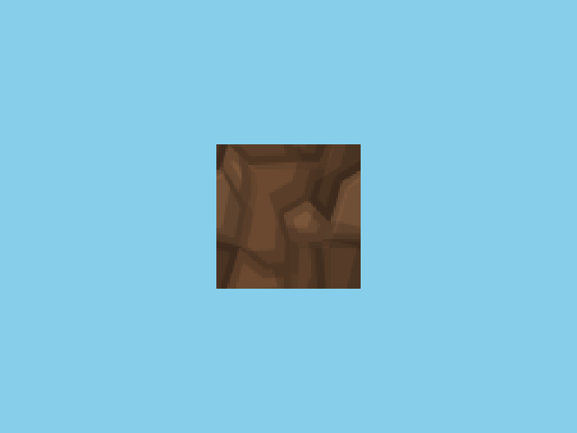
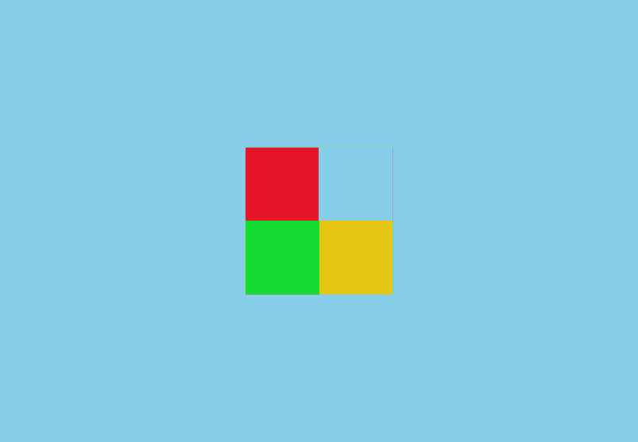

# R2 顺序2查验材料

本目录是 [顺序2实施报告](r2-step2-implementation.md) 的库内查验快照。**822 份 raw 副本、21,766,344 字节**均与原始来源 SHA/长度匹配并只读；保留失败和各轮范围，不移动 out，不归档 exe/DLL/lib，不作为可运行包。当前游戏仍旧 GL，完整世界/玩法、R3、实际 DeviceLost/在途 timeout 未验收。

现行 [validation-manifest.json](validation-manifest.json) 记录 525 项定域源码/构建输入及工具、GPU、测试、原始/副本 SHA；不是完整 vendor headers/SDK/runtime 快照。[validation-initial-001.json](validation-initial-001.json) 保留首次错误聚合，不作为现行身份。[final-check.json](final-check.json) 记录最终原字节、来源、GPU 输入及图片对照核验。

## 最终入口

| 内容 | Debug | Release |
| --- | --- | --- |
| GPU `005`，每配置 4/4 | [汇总](raw/out/m3-t3/r2-step2-gpu-debug-005/verification.json) | [汇总](raw/out/m3-t3/r2-step2-gpu-release-005/verification.json) |
| 1x / 4x，normal 各 320 checks | [1x](raw/out/m3-t3/r2-step2-gpu-debug-005/normal-samples-1/result.json)、[4x](raw/out/m3-t3/r2-step2-gpu-debug-005/normal-samples-4/result.json) | [1x](raw/out/m3-t3/r2-step2-gpu-release-005/normal-samples-1/result.json)、[4x](raw/out/m3-t3/r2-step2-gpu-release-005/normal-samples-4/result.json) |
| 部分初始化与同窗口恢复 | [missing](raw/out/m3-t3/r2-step2-gpu-debug-005/missing-shader/result.json)、[bad](raw/out/m3-t3/r2-step2-gpu-debug-005/bad-shader/result.json) | [missing](raw/out/m3-t3/r2-step2-gpu-release-005/missing-shader/result.json)、[bad](raw/out/m3-t3/r2-step2-gpu-release-005/bad-shader/result.json) |
| 原生配置回归，各 11/11 | [JUnit](raw/out/m3-t3/r2-step2-d3d12-debug-001/ctest-final-004.xml) | [JUnit](raw/out/m3-t3/r2-step2-d3d12-release-001/ctest-final-004.xml) |
| CPU 全量最终 | [52/52 启用通过](raw/out/m3-t3/r2-step2-cpu-debug-001/ctest-final-003.log) | [52/53，1175 失败](raw/out/m3-t3/r2-step2-cpu-release-001/ctest-final-003.log) |
| CPU Renderer/边界，各 8/8 | [JUnit](raw/out/m3-t3/r2-step2-cpu-debug-001/ctest-boundary-final-004.xml) | [JUnit](raw/out/m3-t3/r2-step2-cpu-release-001/ctest-boundary-final-004.xml) |
| 最终原生增量，各四 probes | [结果](raw/out/m3-t3/r2-step2-d3d12-debug-incremental-002/result.json) | [结果](raw/out/m3-t3/r2-step2-d3d12-release-incremental-002/result.json) |
| CPU 增量，各两 probes | [结果](raw/out/m3-t3/r2-step2-cpu-debug-incremental-001/result.json) | [结果](raw/out/m3-t3/r2-step2-cpu-release-incremental-001/result.json) |

## 原失败与轮次边界

- [Debug GPU001](raw/out/m3-t3/r2-step2-gpu-debug-001/verification.json)：两个 normal 的 atlas 测试层序错误；shader 失败/恢复通过。
- [Debug GPU002](raw/out/m3-t3/r2-step2-gpu-debug-002/verification.json)：4x 将全剔除区间真实零时长错误判失败，不是 missing 填零。
- [Debug GPU003](raw/out/m3-t3/r2-step2-gpu-debug-003/verification.json) / [Release GPU003](raw/out/m3-t3/r2-step2-gpu-release-003/verification.json)：当时 4/4，但大位置仅空场景且没有十秒 hold。
- [Debug GPU004](raw/out/m3-t3/r2-step2-gpu-debug-004/verification.json) / [Release GPU004](raw/out/m3-t3/r2-step2-gpu-release-004/verification.json)：真实远深度轴几何已测，仍没有十秒 hold；只有 `005` 含持续段实测。
- CPU [Debug 首轮](raw/out/m3-t3/r2-step2-cpu-debug-001/ctest-001.log)、[Debug 第二轮](raw/out/m3-t3/r2-step2-cpu-debug-001/ctest-002.log) 和 Release 最终保留 Win32 1175；不改 T2/Fix1 状态。
- [首次原生边界失败](raw/out/m3-t3/r2-step2-d3d12-debug-001/ctest-initial-001.log) 是目录标签 `d3d12` 误判泄漏，后续归一化输出前缀并保留真实 SDK/private 路径检查。

## 代表图片

这些是实际生产后端上的固定测试几何，不是世界截图；像素断言限定 RGB，RGBA 只作报告观测。图集 64 层上传、layer 0 四点核对，不扩为所有层逐像素验收。

可再查看 [alpha 前景先画](raw/out/m3-t3/r2-step2-gpu-debug-005/normal-samples-4/06-alpha-discard.png)、[逆序](raw/out/m3-t3/r2-step2-gpu-debug-005/normal-samples-4/06b-alpha-reverse-order.png)、[物理 MSAA 斜边](raw/out/m3-t3/r2-step2-gpu-debug-005/normal-samples-4/06f-physical-msaa-edge.png) 和 [选择框](raw/out/m3-t3/r2-step2-gpu-release-005/normal-samples-4/09-selection.png)。

## 源码与复跑

原字节来源： [backend](raw/game/modules/renderer/src/backend/d3d12/d3d12_backend.cpp)、[pipeline](raw/game/modules/renderer/src/backend/d3d12/pipeline.cpp)、[HLSL](raw/assets/shaders/hlsl/blocks.hlsl)、[CMake](raw/cmake/RendererD3D12.cmake)、[真实 smoke](raw/test/integration/renderer/d3d12_backend_smoke.cpp)。源快照用于查验，不直接从归档执行脚本；复跑使用原工程及新 out 目录，命令见 [报告](r2-step2-implementation.md#复跑与下一步)。

R1 冻结、R1 查验/原始 out 与顺序1 raw 已再次核 SHA，未改写；历史来源和当前运行身份不互相代填。人工入口仍是 [manual-verification](milestones/m3-t3/manual-verification.md)，不在此新建第二张验收清单。
